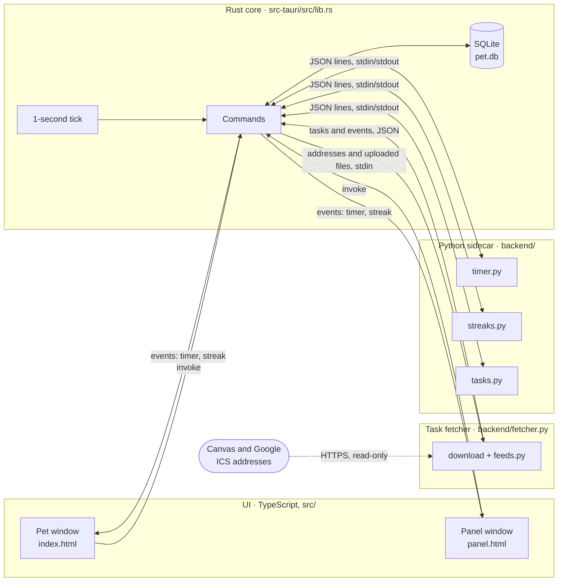
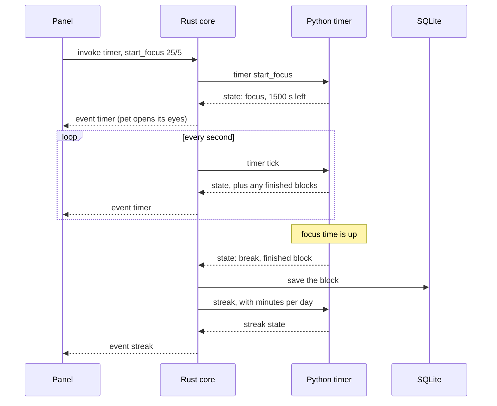
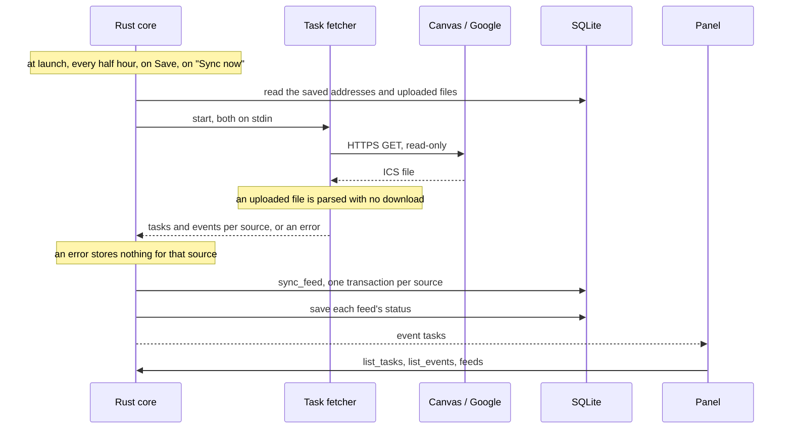
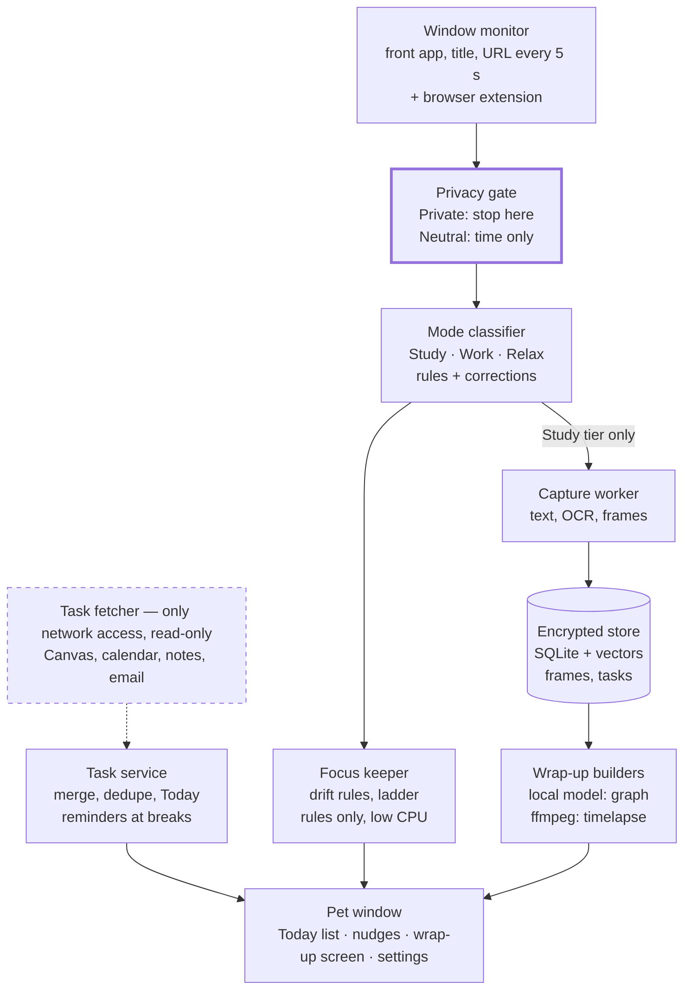

# Architecture

This page has two halves: what is built today (Phase 1 and most of Phase 2), and the full system the spec describes, in the order it gets built. Why each choice was made is in `DECISIONS.md`; what is fragile or unfinished is in `KNOWN_ISSUES.md`.

## The idea in one paragraph

Study Pet is three layers. The **UI** (two small web pages) only draws what it is told. The **Rust core** owns everything that must be held or stored: the windows, the database, the clock tick. The **Python sidecar** holds the rules: given some input, it returns an answer and remembers nothing on disk. Every later phase adds parts to this same shape. The first such part is built: the **task fetcher**, a second Python process that is the only thing allowed on the network.

## Today: Phase 1 and most of Phase 2

| Layer | Where | Its job | It never |
| --- | --- | --- | --- |
| UI | `src/pet`, `src/panel` | Draw the state, send button presses | Keeps state of its own |
| Rust core | `src-tauri/src/lib.rs` | Windows, database, tick, passing messages | Decides timer, streak or parsing rules |
| Python sidecar | `backend/main.py` | Timer and streak rules, quick-add parsing | Touches the database or the network |
| Task fetcher | `backend/fetcher.py`, `backend/feeds.py` | Downloads the saved feeds, reads uploaded .ics files, and turns both into tasks and events; started for each sync, then exits | Touches the database, writes anywhere, or shows a feed address |

**The database** has six tables.

| Table | Holds | Used yet |
| --- | --- | --- |
| `preset` | Saved focus and break lengths | Yes |
| `session` | Finished focus blocks, each with an optional `task_id` | Yes; `task_id` is not filled in yet |
| `setting` | The streak goal, whether sounds are on, the feed addresses or uploaded .ics files, and each feed's last sync result | Yes |
| `task` | Typed and imported tasks: title, course, due, estimate, status, and `hidden_at` for an imported task the user deleted | Yes |
| `task_source_link` | Which imported item a task came from; `(source, source_uid)` is unique so a re-import cannot duplicate; `removed_at` marks one that left its feed | Yes |
| `calendar_event` | Imported calendar events from yesterday to 30 days ahead, replaced on every sync | Yes |

### How the layers talk

- **UI to Rust:** `invoke("command_name", args)`. The commands are `timer`, `streak`, `day`, `list_presets`, `add_preset`, `delete_preset`, `set_streak_threshold`, `sounds`, `merge_task`, `list_courses`, `set_course`, `connect_google`, `add_task`, `list_tasks`, `set_task_done`, `delete_task`, `feeds`, `set_feed`, `set_feed_file`, `sync_now`, `list_events`, `toggle_panel` and `backend_call`.
- **Rust to UI:** `timer` and `streak` events, sent to both windows at once. This is why the pet and the panel always agree. A third event, `tasks`, carries no data: it is sent after each feed sync, and the panel reloads its tasks, schedule and feed status. After its own changes the panel just reloads.
- **Sounds:** the tick thread in `lib.rs` compares each new timer state with the last one it rang for. A break that starts plays Glass, and each call back plays Ping, through `afplay` (macOS only). No window is involved, so it works with the panel closed and the pet hidden.
- **Rust to the sidecar:** one line of JSON in, one line out: `{"method": "timer", "params": {...}}` returns `{"ok": ...}` or `{"error": ...}`.
- **Rust to the fetcher:** one JSON object in on stdin, `{"feeds": {"canvas": address, ...}, "files": {"google": ics text, ...}, "accounts": {"google": client and refresh token}}` (or `{"connect": {"google": client}}` to sign in), and one out, with `{"ok": [items]}` or `{"error": "..."}` for each source. The process then exits.

### One example: a focus block, start to finish

The tick is the heartbeat. Python decides when a phase changes, Rust stores the result and tells the windows.

### A second example: adding a task

The panel sends the typed line to `add_task`. Rust asks SQLite for today's local date, passes the line and the date to `quick_add` in the sidecar, and inserts the fields that come back into `task`. The panel then calls `list_tasks` and redraws. Python parsed the line and Rust stored it; neither did the other's job.

### A third example: a feed sync

What `sync_feed` does with a source's items:

- **A new assignment** becomes a `task` and a `task_source_link`, unless its due day has already passed.
- **A known assignment** has its title, course and due date overwritten. Its done status is never touched.
- **An upcoming assignment missing from the feed** gets `removed_at` on its link; the panel shows "removed from Canvas". The flag clears if it returns.
- **Events** for that source are deleted and replaced with the feed's copy.

Deleting an imported task in the panel sets `hidden_at` instead of removing the row, so the link survives and the next sync does not import it again.

### The windows and macOS Spaces

The pet is set in `tauri.conf.json` to show on every Space, so it follows the user between desktops. The panel is a normal window that lives on one Space at a time; at startup Rust sets its AppKit collection behavior to move to the active Space (`move_to_active_space` in `lib.rs`, macOS only), so a click on the pet opens the panel where the user is. This is the one place the core calls AppKit directly, through `objc2-app-kit`.

### Adding a feature in this shape

1. **Rule** (a calculation or a state machine): write a function in `backend/`, using only the standard library, add it to `METHODS` in `backend/main.py`, and give it a test in `backend/tests/`.
2. **Storage**: add the table in `init_db` and a command in `lib.rs`, then list the command in `generate_handler!`.
3. **Screen**: call the command with `invoke` and draw the result. If both windows need it, have Rust `emit` an event instead.

## The full system

Read it as two separate paths that only meet at the pet window:

- **The watching path** (top to bottom): what is on screen, is it allowed, what kind of activity is it, then nudge or capture.
- **The task path** (dashed): fetch tasks from other apps, merge them, show Today.

### The parts, in build order

| Part | Phase | What it does | Lives in | Built with |
| --- | --- | --- | --- | --- |
| Pet window and panel | 1 | Shows everything; the only thing the user sees | UI | Tauri, TypeScript |
| Timer and streak | 1 | Sessions, breaks, daily goal | Python | Standard library |
| Task service | 2 | The pet's own list; merges and dedupes imports; builds Today | Rust + Python | SQLite |
| Task fetcher | 2, 6 | Reads Canvas, calendars, notes and email. Canvas and calendar ICS feeds are built | Its own process | `icalendar`, read-only APIs |
| Window monitor | 3 | Reads the front app, title and URL every 5 s | Rust + browser extension | NSWorkspace, Accessibility API |
| Privacy gate | 3 | Stops Private windows before anything else sees them | Rust | Rules in the `app_rule` table |
| Mode classifier | 3 | Labels time as Study, Work, Relax or Private | Python | Rules, no model |
| Focus keeper | 3 | Notices drift and escalates gently | Python | Rules, no model |
| Capture worker | 4 | Saves text and low-res frames from Study windows | Rust + Python | ScreenCaptureKit, PyMuPDF, OCR |
| Encrypted store | 4 | The same database, now encrypted | Rust | SQLCipher, sqlite-vec |
| Wrap-up builders | 4, 5 | Timelapse, then the knowledge graph | Its own Python process | ffmpeg, Ollama or llama.cpp |

Each part plugs into the Phase 1 shape: things that watch or store go in Rust, things that decide go in Python, and the windows only draw.

### Processes

By the end there are four processes, split by what each is allowed to do. The first, second and fourth exist today:

| Process | Network | Runs |
| --- | --- | --- |
| Tauri app (Rust core + UI) | No | Always |
| Python sidecar (rules) | No | Always |
| Wrap-up builder (graph, timelapse) | No | Once a day |
| Task fetcher | Yes, read-only, HTTPS only | At launch, every half hour, and on request; it exits after each run |

### Three rules that must always hold

1. **The privacy gate runs first.** A Private window is never captured, rather than captured and then deleted (PR-1).
2. **Only the task fetcher touches the network.** Captured data never leaves the laptop (PR-6). The fetcher is handed feed addresses, uploaded files and, for a signed-in Google account, the client and refresh token, and nothing else; it has no access to the database or the Keychain.
3. **Real-time work uses rules only.** The model runs once, at wrap-up, so the pet stays light all day.
