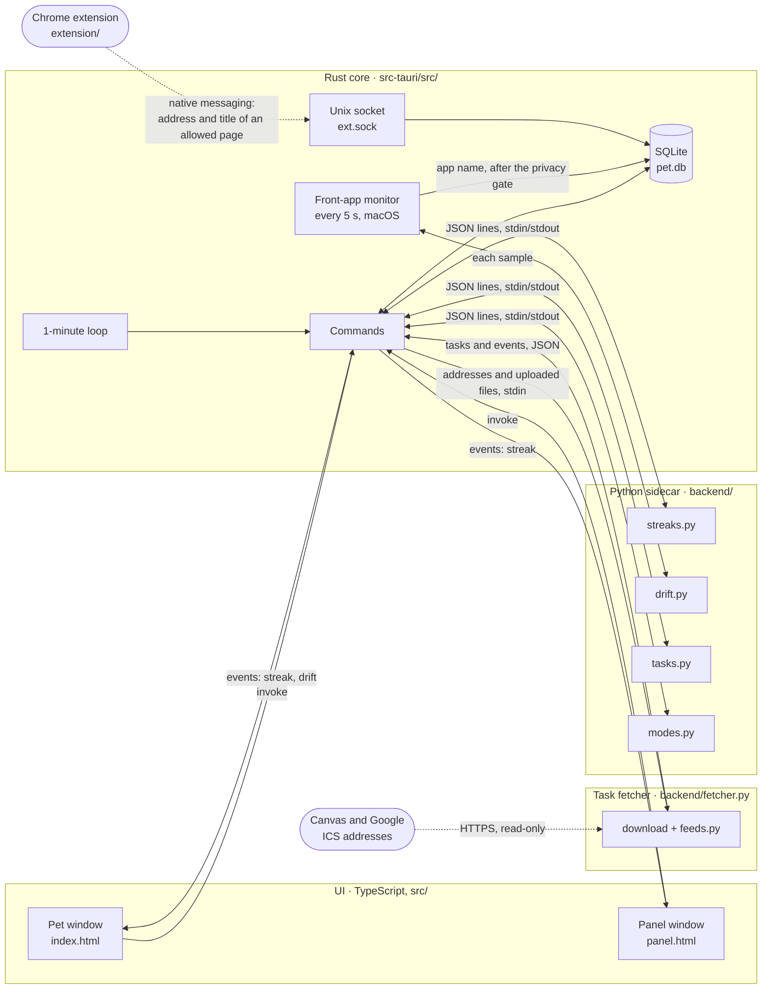
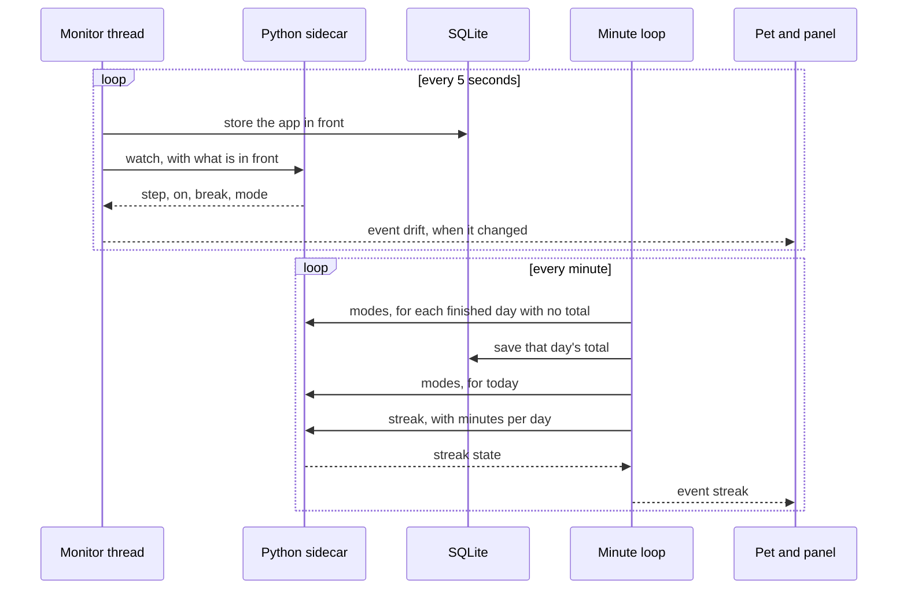
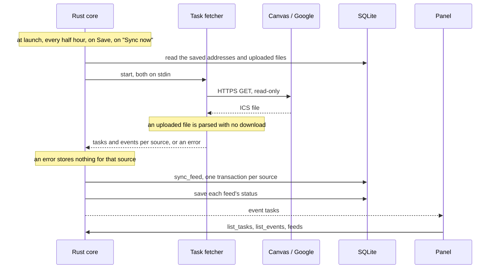
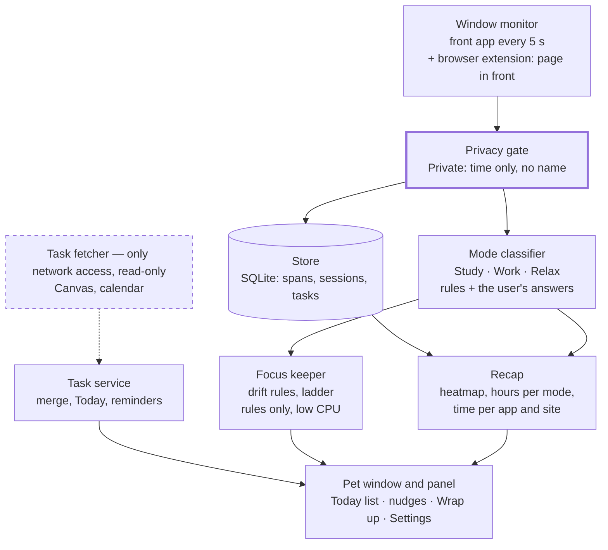

# Architecture

This page has two halves: what is built today, and the full system the spec describes, in the order it was built. Why each choice was made is in `DECISIONS.md`; what is fragile or unfinished is in `KNOWN_ISSUES.md`.

## The idea in one paragraph

Study Pet is three layers. The **UI** (two small web pages) only draws what it is told. The **Rust core** owns everything that must be held or stored: the windows, the database, the once-a-minute loop. The **Python sidecar** holds the rules: given some input, it returns an answer and remembers nothing on disk. Every later phase adds parts to this same shape. The first such part is built: the **task fetcher**, a second Python process that is the only thing allowed on the network.

## Today: Phases 1 to 4

| Layer | Where | Its job | It never |
| --- | --- | --- | --- |
| UI | `src/pet`, `src/panel` | Draw the state, send button presses | Keeps state of its own |
| Rust core | `src-tauri/src/` (`lib.rs` and ten modules) | Windows, database, the minute loop, the front-app monitor, the extension's socket, passing messages | Decides streak, keeper, parsing or mode rules |
| Python sidecar | `backend/main.py` | Streak and keeper rules, quick-add parsing, mode labels | Touches the database or the network |
| Task fetcher | `backend/fetcher.py`, `backend/feeds.py` | Downloads the saved feeds, reads uploaded .ics files, and turns both into tasks and events; started for each sync, then exits | Touches the database, writes anywhere, or shows a feed address |
| Chrome extension | `extension/` | Asks once per site, and sends the address and title of an allowed page in front every 5 s | Keeps what it sends, or sends anything while the app is closed |

**The database** has twelve tables.

| Table | Holds | Used yet |
| --- | --- | --- |
| `preset` | Saved focus and break lengths | No. Left from the focus-block timer, removed 2026-10-13 |
| `session` | Focus blocks from before 2026-10-13, each with an optional `task_id`. None is added now | Read for the streak and heatmap of days before `auto_since`, and for an old task's work left |
| `day_total` | A finished day's Study and Work seconds, saved once; emptied when an app rule changes | Yes |
| `setting` | The streak goal, whether sounds are on, the feed addresses or uploaded .ics files, each feed's last sync result, `auto_since` (the first day recorded time counts) and `break_after_min` | Yes |
| `task` | Typed and imported tasks: title, course, due, estimate, status, and `hidden_at` for an imported task the user deleted | Yes |
| `task_source_link` | Which imported item a task came from; `(source, source_uid)` is unique so a re-import cannot duplicate; `removed_at` marks one that left its feed | Yes |
| `calendar_event` | Imported calendar events from yesterday to 30 days ahead, replaced on every sync | Yes |
| `activity_span` | Pages from the Chrome extension: site, address, title, start and end | Yes |
| `audio_span` | That sound was on, from any app: start and end only, never what was playing (PR-11) | Yes |
| `app_span` | The app in front, from the window monitor: name, bundle ID, start and end. No window title | Yes |
| `app_rule` | What the user said an app or site is for (Study, Work, Relax or Private), and which ones the pet has already asked about | Yes |
| `mode_declaration` | The mode the user said they were in ("Right now I'm relaxing"), with its start and end | Yes |

### How the layers talk

- **UI to Rust:** `invoke("command_name", args)`. The commands are `streak`, `day`, `set_streak_threshold`, `sounds`, `merge_task`, `list_courses`, `set_course`, `connect_google`, `add_task`, `list_tasks`, `set_task_done`, `delete_task`, `feeds`, `set_feed`, `set_feed_file`, `sync_now`, `list_events`, `toggle_panel`, `modes_day`, `declared_mode`, `learned`, `keeper`, `audio_time` and `accessibility`. `accessibility` is compiled only on macOS.
- **Rust to UI:** the `streak` event, sent to both windows at once. This is why the pet and the panel always agree. The `drift` event carries the keeper's state with each change in what is in front: the ladder's step, whether the keeper is on, the mode and whether sound is on. A third event, `tasks`, carries no data: it is sent after each feed sync, and the panel reloads its tasks, schedule and feed status. After its own changes the panel just reloads. A fourth, `reminder`, carries one line of text for the pet's bubble: a task due soon, "Did you submit it?", a question about an app or site the pet does not recognize, or the suggestion to take a break.
- **Sounds:** when the keeper says a break is due, the monitor thread plays Glass through `afplay` (macOS only). No window is involved, so it works with the panel closed and the pet hidden.
- **Rust to the sidecar:** one line of JSON in, one line out: `{"method": "streak", "params": {...}}` returns `{"ok": ...}` or `{"error": ...}`. The methods are `ping`, `streak`, `modes`, `watch` and `quick_add`. An error a method raises is passed back to the caller and the process stays, because the keeper's state lives in it; the process is replaced only when the pipe or the reply is broken (`sidecar_call`, `sidecar.rs`). The UI cannot name a sidecar method: each one is reached through its own Rust command.
- **Rust to the fetcher:** one JSON object in on stdin, `{"feeds": {"canvas": address, ...}, "files": {"google": ics text, ...}, "accounts": {"google": client and refresh token}}` (or `{"connect": {"google": client}}` to sign in), and one out, with `{"ok": [items]}` or `{"error": "..."}` for each source. A crash while reading one source is that source's error, so the others still sync. The process then exits.
- **The Chrome extension to Rust:** native messaging. Chrome starts a two-line host script (`chrome-host.sh`, written beside `pet.db` at launch) that passes the extension's messages to a Unix socket (`ext.sock`) the app listens on. The host is named after the app's identifier, so the dev and the everyday app each have one; the extension tries the everyday app first. Each message is `{"url", "title"}` for the allowed page in front.
- **Locks:** the database connection, the sidecar and the sync each sit behind one lock. The database and sync locks are taken with `lock` in `db.rs`, which carries on after a thread has panicked while holding one; the sidecar's lock does the same and starts a fresh process.

### One example: a day counts by itself

Nothing is started by the user. `Keeper` in `backend/drift.py` adds up Study and Work time, turns the keeper on at 5 minutes, runs the ladder, and says when a break is due. A day's minutes are its Study and Work seconds: a finished day's are saved once in `day_total`, and today's are worked out each time. A day before `auto_since` has the minutes of its focus blocks.

### A second example: adding a task

The panel sends the typed line to `add_task`. Rust asks SQLite for today's local date, passes the line and the date to `quick_add` in the sidecar, and inserts the fields that come back into `task`. The panel then calls `list_tasks` and redraws. Python parsed the line and Rust stored it; neither did the other's job.

### A third example: a feed sync

What `sync_feed` does with a source's items:

- **A new assignment** becomes a `task` and a `task_source_link`, unless its due day has already passed.
- **A known assignment** has its title, course and due date overwritten. Its done status is never touched.
- **An upcoming assignment missing from the feed** gets `removed_at` on its link; the panel shows "removed from Canvas". The flag clears if it returns.
- **Events** for that source are deleted and replaced with the feed's copy.

Deleting an imported task in the panel sets `hidden_at` instead of removing the row, so the link survives and the next sync does not import it again.

### A fourth example: where the time went

1. **Every 5 seconds** the monitor thread (`monitor.rs`) asks macOS for the app in front. The sample passes the privacy gate first: an app on the built-in list, or one the user made Private, is kept as "Private" with no name or bundle ID. Samples of the same app join into one `app_span` row.
2. **Every 5 seconds** the extension sends the address and title of the page in front, if the user said yes for that site. `browser.rs` drops a site the user made Private in the app, and joins samples of the same address into one `activity_span` row.
3. **While the pet looks away** both are dropped (C-4): each checks `paused` in `browser.rs`.
4. **When asked** (`modes_day`, for today or any earlier local day), Rust sends that day's rows from both tables, the declarations, the learned rules and any focus blocks from before 2026-10-13 to `label_day` in `backend/modes.py`. It returns the labeled stretches, the seconds per mode, the time per app and site, and the apps and sites nothing recognizes. Rust then puts a name in place of each site's address (`name_sites` in `modes.rs`). Nothing of this is stored.
5. **Once a minute**, while the keeper is off and when no task reminder is due, the minute loop takes the first unknown the pet has not asked about, marks it in `app_rule`, and sends it as a `reminder` event. The panel lists every open question; an answer is a row in `app_rule`.

### The windows and macOS Spaces

The pet is set in `tauri.conf.json` to show on every Space, so it follows the user between desktops. The panel is a normal window that lives on one Space at a time; at startup Rust sets its AppKit collection behavior to move to the active Space (`move_to_active_space` in `windows.rs`, macOS only), so a click on the pet opens the panel where the user is. This is the one place the core calls AppKit directly, through `objc2-app-kit`.

### Adding a feature in this shape

1. **Rule** (a calculation or a state machine): write a function in `backend/`, using only the standard library, add it to `METHODS` in `backend/main.py`, and give it a test in `backend/tests/`.
2. **Storage**: add the table in `init_db` (`db.rs`) and a command in the module it belongs to (`tasks.rs`, `feeds.rs`, ...), marked `pub(crate)`, then list it by path in `generate_handler!` in `lib.rs`, such as `tasks::add_task`.
3. **Screen**: call the command with `invoke` and draw the result. If both windows need it, have Rust `emit` an event instead.

## The full system

The plan changed on 2026-10-11: the capture worker, the encrypted store and the wrap-up builders (timelapse and knowledge graph) were dropped. What follows is the whole system as it will stay; every part is built.

Read it as two separate paths that only meet at the pet window:

- **The watching path** (top to bottom): what is in front, is it allowed, what kind of activity is it, then nudge, and later recap.
- **The task path** (dashed): fetch tasks from other apps, merge them, show Today.

### The parts, in build order

| Part | Phase | What it does | Lives in | Built with |
| --- | --- | --- | --- | --- |
| Pet window and panel | 1 | Shows everything; the only thing the user sees | UI | Tauri, TypeScript |
| Streak | 1 | The daily goal, counted from recorded Study and Work time | Python | Standard library |
| Task service | 2 | The pet's own list; merges imports; builds Today | Rust + Python | SQLite |
| Task fetcher | 2 | Reads Canvas and calendar feeds | Its own process | `icalendar`, read-only APIs |
| Window monitor | 3 | Notes the front app every 5 s, and the address and title of an allowed page. The window title is not read | Rust + browser extension | NSWorkspace, Accessibility API |
| Privacy gate | 3 | Stops Private apps, sites and windows from being named | Rust | A built-in list, and rules in the `app_rule` table |
| Mode classifier | 3 | Labels time as Study, Work, Relax or Private | Python | Rules, no model |
| Focus keeper | 3 | Turns itself on after 5 minutes of Study or Work, notices drift and escalates gently, and suggests a break | Python | Rules, no model |
| Recap | 4 | Heatmap, hours per mode and time per app and site, for any day (R-1 to R-5 in `spec.md`). The panel draws the heatmap from `day`; `modes_day` labels one day's rows and names its sites | Rust + Python + UI | What is already stored |

Each part plugs into the Phase 1 shape: things that watch or store go in Rust, things that decide go in Python, and the windows only draw.

### Processes

There are three processes, split by what each is allowed to do. Chrome also starts the extension's host script, which only passes bytes to the app's socket and ends when the app quits:

| Process | Network | Runs |
| --- | --- | --- |
| Tauri app (Rust core + UI) | No | Always |
| Python sidecar (rules) | No | Always |
| Task fetcher | Yes, read-only, HTTPS only | At launch, every half hour, and on request; it exits after each run |

### Three rules that must always hold

1. **The privacy gate runs first.** A Private window is never named, rather than named and then deleted (PR-1).
2. **Only the task fetcher touches the network.** What the pet notes never leaves the laptop (PR-6). The fetcher is handed feed addresses, uploaded files and, for a signed-in Google account, the client and refresh token, and nothing else; it has no access to the database or the Keychain.
3. **Everything runs on rules.** There is no model, so the pet stays light all day.
