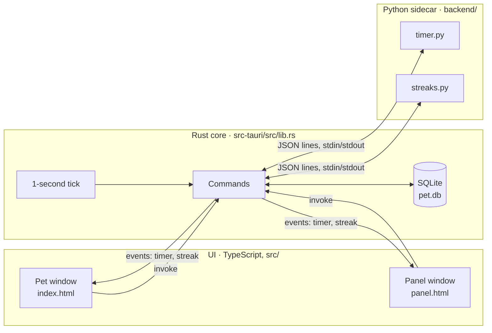
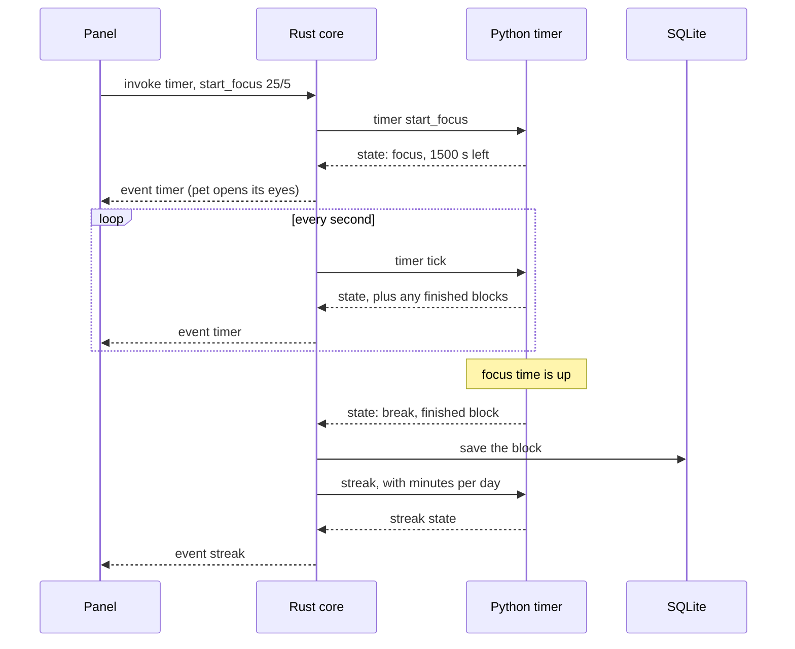
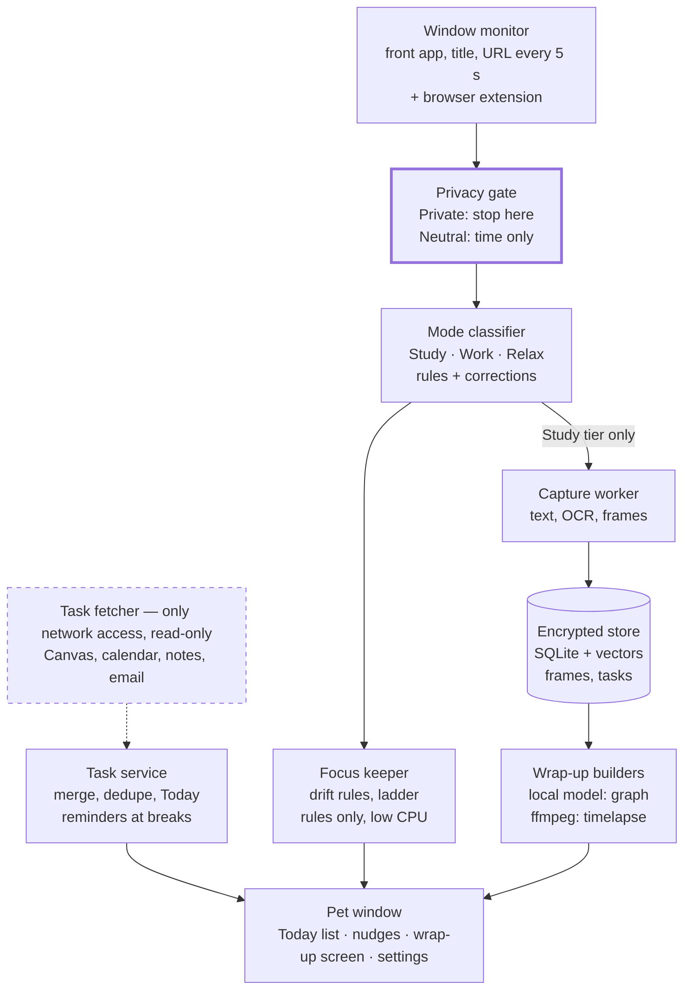

# Architecture

This page has two halves: what is built today (Phase 1), and the full system the spec describes, in the order it gets built. Why each choice was made is in `DECISIONS.md`.

## The idea in one paragraph

Study Pet is three layers. The **UI** (two small web pages) only draws what it is told. The **Rust core** owns everything that must be held or stored: the windows, the database, the clock tick. The **Python sidecar** holds the rules: given some input, it returns an answer and remembers nothing on disk. Every later phase adds parts to this same shape.

## Today: Phase 1

| Layer | Where | Its job | It never |
| --- | --- | --- | --- |
| UI | `src/pet`, `src/panel` | Draw the state, send button presses | Keeps state of its own |
| Rust core | `src-tauri/src/lib.rs` | Windows, database, tick, passing messages | Decides timer or streak rules |
| Python sidecar | `backend/` | Timer and streak rules | Touches the database or the network |

**The database** has three tables: `preset` (saved focus and break lengths), `session` (finished focus blocks) and `setting` (the streak goal).

### How the layers talk

- **UI to Rust:** `invoke("command_name", args)`. The commands are `timer`, `streak`, `day`, `list_presets`, `add_preset`, `delete_preset`, `set_streak_threshold`, `toggle_panel` and `backend_call`.
- **Rust to UI:** two events, `timer` and `streak`, sent to both windows at once. This is why the pet and the panel always agree.
- **Rust to Python:** one line of JSON in, one line out: `{"method": "timer", "params": {...}}` returns `{"ok": ...}` or `{"error": ...}`.

### One example: a focus block, start to finish

The tick is the heartbeat. Python decides when a phase changes, Rust stores the result and tells the windows.

### Adding a feature in this shape

1. **Rule** (a calculation or a state machine): write a function in `backend/`, add it to `METHODS` in `backend/main.py`, and give it a test in `backend/tests/`.
2. **Storage**: add the table in `init_db` and a command in `lib.rs`, then list the command in `generate_handler!`.
3. **Screen**: call the command with `invoke` and draw the result. If both windows need it, have Rust `emit` an event instead.

## The full system

Read it as two separate paths that only meet at the pet window:

- **The watching path** (top to bottom): what is on screen, is it allowed, what kind of activity is it, then nudge or capture.
- **The task path** (dashed): fetch tasks from other apps, merge them, show Today.

### The parts, in build order

| Part | Phase | What it does | Lives in | Built with |
| --- | --- | --- | --- | --- |
| Pet window and panel | 1 | Shows everything; the only thing the user sees | UI | Tauri, TypeScript |
| Timer and streak | 1 | Sessions, breaks, daily goal | Python | Standard library |
| Task service | 2 | The pet's own list; merges and dedupes imports; builds Today | Rust + Python | SQLite |
| Task fetcher | 2, 6 | Reads Canvas, calendars, notes and email | Its own process | ICS, read-only APIs |
| Window monitor | 3 | Reads the front app, title and URL every 5 s | Rust + browser extension | NSWorkspace, Accessibility API |
| Privacy gate | 3 | Stops Private windows before anything else sees them | Rust | Rules in the `app_rule` table |
| Mode classifier | 3 | Labels time as Study, Work, Relax or Private | Python | Rules, no model |
| Focus keeper | 3 | Notices drift and escalates gently | Python | Rules, no model |
| Capture worker | 4 | Saves text and low-res frames from Study windows | Rust + Python | ScreenCaptureKit, PyMuPDF, OCR |
| Encrypted store | 4 | The same database, now encrypted | Rust | SQLCipher, sqlite-vec |
| Wrap-up builders | 4, 5 | Timelapse, then the knowledge graph | Its own Python process | ffmpeg, Ollama or llama.cpp |

Each part plugs into the Phase 1 shape: things that watch or store go in Rust, things that decide go in Python, and the windows only draw.

### Processes

By the end there are four processes, split by what each is allowed to do:

| Process | Network | Runs |
| --- | --- | --- |
| Tauri app (Rust core + UI) | No | Always |
| Python sidecar (rules) | No | Always |
| Wrap-up builder (graph, timelapse) | No | Once a day |
| Task fetcher | Yes, read-only | On a schedule |

### Three rules that must always hold

1. **The privacy gate runs first.** A Private window is never captured, rather than captured and then deleted (PR-1).
2. **Only the task fetcher touches the network.** Captured data never leaves the laptop (PR-6).
3. **Real-time work uses rules only.** The model runs once, at wrap-up, so the pet stays light all day.
