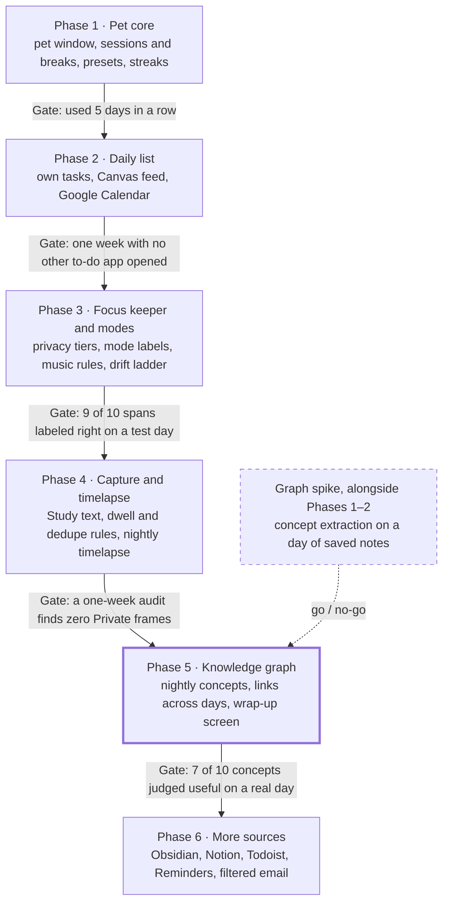

# Roadmap

Phases ship in order, and each gate must pass before the next phase starts. Requirement IDs (P-1, C-5, ...) refer to `spec.md`. Why each tool was chosen is in `DECISIONS.md`.

## Phase 1 · Pet core (done)

**Builds:** the pet window, the panel, the session timer and the streak.

**Features**
- A transparent, always-on-top pet that can be dragged and hidden with one shortcut (P-1).
- Eyes open only while a focus block runs (P-2).
- A panel with Today, Wrap up and Settings (P-3).
- Focus and break lengths per session, with saved presets (S-1).
- Breaks, a call back when the break ends, repeated once after 2 minutes (S-3, S-4).
- A suggestion to take a real break after 3 skipped in a row (S-5).
- Blocks of any length count toward the day (S-6).
- Streak: a day counts at 25 minutes (adjustable), 2 freezes a month, milestones at 7, 30 and 100 days.

**Uses:** Tauri 2 (Rust core), Vite with plain TypeScript, a Python sidecar over JSON lines, SQLite through `rusqlite`, the Tauri global-shortcut plugin, `objc2-app-kit` on macOS for window behavior Tauri does not expose.

**Tasks**
- [x] Scaffold Tauri, Vite and the Python sidecar
- [x] Pet window: transparent, drag, click to open the panel, `Alt+Shift+P` to hide
- [x] Pet on every macOS Space; the panel opens on the current one
- [x] Panel with three views
- [x] Timer state machine and its tests (`backend/timer.py`)
- [x] Presets and finished focus blocks stored in SQLite
- [x] Streak rules and their tests (`backend/streaks.py`)
- [x] Wrap-up view with the last 7 days
- [x] Use it 5 days in a row and write down what breaks -> Pet is working properly for 5 days (*note that can not code while open pet)

**Gate:** used 5 days in a row.

## Graph spike (alongside Phases 1–2)

**Builds:** a throwaway script, not part of the app. It answers one question: are the extracted concepts useful?

**Features:** none for the user. The output is a go / no-go for Phase 5.

**Uses:** a Python script, Ollama or llama.cpp with a small open model, one day of saved study notes as input.

**Tasks**
- [ ] Save one real day of study text (notes, a PDF, two web pages)
- [ ] Extract 5 to 15 concepts per source with the local model
- [ ] Judge 10 concepts by hand: useful or noise
- [ ] Record the result and the model used in `DECISIONS.md`

**Gate:** go / no-go for Phase 5.

## Phase 2 · Daily list (in progress)

**Builds:** the pet's own to-do list, the Today view, and the first two read-only feeds.

**Features**
- Quick add by typing, such as "STAT 310 HW3 Fri 2h"; the pet parses course, due date and estimate.
- Two views: Today and All. Today is built at 7 am or first wake.
- Canvas assignments and calendar events merged into the list, never written back.
- A session can be tied to a task (S-2).
- Typed quick commands, such as "start 50 minutes" (P-4). Optional, skipped for now.
- Reminders timed by due date against the estimate, held until the next break.

**Uses:** new `task`, `task_source_link` and `calendar_event` tables in SQLite, the Canvas calendar feed (ICS), Google Calendar's secret iCal address or a read-only sign-in (OAuth, with the refresh token in the macOS Keychain), the `icalendar`, `recurring-ical-events` and `certifi` packages, a separate task-fetcher process that is the only one with network access (PR-6). Feed addresses and the Google token are in the macOS Keychain; the database itself is not encrypted yet, so PR-4 is only partly met (see `KNOWN_ISSUES.md`).

**Tasks**
- [x] Task tables and a migration
- [x] Quick-add parser and its tests (`backend/tasks.py`)
- [x] Task list in the panel: add, check off, delete
- [x] Today and All views in the panel (a filter over one list; Today is not yet built at 7 am or stored in `planned_for`)
- [x] ICS feed parser and its tests (`backend/feeds.py`), checked against a real Canvas feed
- [x] Feed storage with the sync rules for done status and removed items (`sync_feed` in `feeds.rs`)
- [x] Task fetcher process, separate from the offline sidecar (`backend/fetcher.py`)
- [x] Canvas ICS import with stable source IDs; feed address set in Settings
- [x] Calendar import by Google's secret iCal address; today's events listed in the panel
- [x] Upload an exported .ics file where a calendar has no address
- [x] Pixel-slime pet with closed and open eyes, shown in the panel and as the app icon
- [x] Look at the new pet in the real window: focus block (eyes open), call back (hop), a milestone star
- [x] Rebuild and reinstall the everyday app so it gets the new pet and icon (done 2026-10-04, on 2026-10-05 from commit `c90c6af`, four times on 2026-10-07, and on 2026-10-08 with all of Phase 3 and signed; do it again after any change it should get, and back up its `pet.db` first)
- [x] Commit the new pet, icon and docs; the installed app was built from uncommitted files
- [x] Set the version to 0.2.0 in `package.json`, `Cargo.toml` and both Tauri configs
- [x] Wake-up splash from the logo design (optional; in `pet.css`, not yet looked at in the real window)
- [x] Try the Google import against a real calendar or export (only a made-up feed so far)
- [x] Google Calendar by read-only OAuth, so the calendar updates without uploading a file again (primary calendar only; design in `google_calendar_oauth.md`; signed in from the dev app on 2026-10-05, the everyday app gets it when Phase 2 is finished)
- [x] Feed addresses in the OS keychain (PR-4): moved at launch in the dev app; an uploaded .ics file's text is still in the database
- [x] Merge a typed task with its imported copy (the pet suggests when the due day and course number match; the user confirms)
- [x] Let the user choose which courses to show (checkboxes in Settings). Choosing Google calendars is left out: the primary calendar had everything
- [x] Tie a session to a task; show time spent against the estimate. When a tied focus block ends, the panel asks "Finished it?" and a yes checks the task off (in the panel only, not yet in the pet's bubble)
- [ ] Quick commands (optional, for a later build; skipped on 2026-10-05 and not needed to finish Phase 2. Every action they would cover is already a click or two, and "I'm relaxing" needs the modes from Phase 3)
- [x] Task reminders: the pet speaks up when the time left until a task is due falls under twice the work left (estimate less time spent; 1 hour assumed with no estimate). Once a day per task, never during a focus block, and the task's row is marked "start soon"
- [ ] Later: hold reminders for the next break with the spec's "unless due within 2 hours" rule, and the morning brief
- [x] "Did you submit it?": once a Canvas task's due time has passed, the pet asks once (not during a focus block), and the task's row has a "Did you submit it? Yes" button that checks it off. This stands in for Canvas submission status, which needs an API token the school does not give out
- [x] A sound when a break starts and when the pet calls you back, with a checkbox in Settings to turn it off (macOS system sounds)
- [x] Streak section in the Today view with a pixel fire, in place of the one-line streak text
- [x] Panel enlarged to 1000 × 700
- [x] "Sync now" in Settings says whether the sync worked (seen working in the app on 2026-10-07)
- [x] Hear the sounds at a real break, and look at the streak section and the wider panel in the running app (`KNOWN_ISSUES.md`, items 47 and 49) (gone through by hand on 2026-10-08; it looked right)

**Decided:** `icalendar` with `recurring-ical-events` parses ICS. OAuth uses no library: the standard library covers the sign-in, and the `security` tool reaches the Keychain.

**Gate:** one week with no other to-do app opened.

## Phase 3 · Focus keeper and modes (in progress)

**Builds:** the window monitor, the privacy gate, the mode classifier and the drift ladder. Nothing on screen is stored yet, only app names and time.

**Features**
- Every stretch of time labeled Study, Work, Relax or Private, with 3-minute smoothing.
- Privacy tiers: the pet asks "Can I look at this?" the first time an app or site appears (PR-2).
- A shortcut that makes the pet look away for 15 minutes (PR-3).
- Drift ladder: glance at 30 s, speech bubble at 2 min, sits on the window at 5 min, opt-in block at 10 min.
- Music rules: background audio never changes the mode; the pet wears headphones.
- Personality choice: Gentle, Sassy or Roast.
- The pet offers to start a session when it sees study with none running (S-7).
- Front app, title and URL read every 5 s; capture pauses on breaks and in Relax (C-1 to C-4).

**Uses:** NSWorkspace and the Accessibility API from Rust, a Chrome or Edge extension for the URL and YouTube player state, new `activity_span`, `app_span`, `app_rule` and `mode_declaration` tables, rules only (no model) to stay under 5% CPU.

**Tasks**
- [x] Split `lib.rs` into modules before the monitor adds to it (no change in behavior; run the app once to confirm)
- [x] Window monitor, front app: `monitor.rs` asks macOS for the app in front every 5 s and keeps its name, bundle ID and time in `app_span`; "Apps today" in Wrap up lists time per app. Not during a break, and not the pet itself or the lock screen (2026-10-07; the tests pass and macOS answered with the real front app, but the running app and the new list have not been looked at)
- [ ] Window monitor, window title (C-1): not built. The Accessibility permission is used only to see whether the keyboard is in a password field (`KNOWN_ISSUES.md`, item 73)
- [x] Run the app and look at "Apps today": a span per app, nothing during a break, nothing for the pet's own panel
- [x] Browser extension that reports the URL: `extension/` for Chrome asks "can I look at this page?" on every page opened, remembering nothing, and sends the address and title of an allowed page in front every 5 s; the app keeps them in `activity_span` and lists time per site in Wrap up (2026-10-07, built ahead of the window monitor by choice; the app side was run with made-up pages, the extension itself has not been loaded in Chrome yet)
- [x] Load the extension in Chrome and try it: the banner, the popup, a span for a real page, nothing during a break or with the app closed
- [x] Onboarding that explains each OS permission before asking (PR-10): a "Permissions" section in Settings explains Accessibility, shows whether it is allowed, and holds the only button that makes macOS ask (2026-10-07; the check was run and answered "not allowed", the button and the macOS question have not been tried)
- [x] Press "Ask macOS for it" in the running app and turn the permission on: the line should change to "allowed" when the panel comes back to the front
- [x] Privacy gate with default Private apps, running before anything else (PR-1): every front-app sample passes through `gate` in `monitor.rs` before it is stored, and a password manager, chat or mail app on the built-in list is kept as "Private" with no name or bundle ID (2026-10-07; tested with made-up samples, not yet seen in the running app). For pages, the extension's yes or no on each page is the gate
- [x] Private windows inside ordinary apps (PR-1): a sample is kept as "Private" while the keyboard is in a password field in any app (through the Accessibility permission), while a Chrome incognito window is in front, and while the page in front in Chrome shows a password field; such a page is not sent by the extension either (2026-10-07; the tests pass and the password check answered "no" with no password field in use, but none of the three has been seen turning a real span Private)
- [x] Reload the extension (0.5.0 now), run the app and try it: an incognito window, a sign-in page, and a password prompt in another app should each show as "Private" time in "Apps today" (gone through by hand on 2026-10-08; it looked right)
- [x] Mode classifier: declaration, learned rule, app category, context (`backend/modes.py`, with tests): today's app and page spans are labeled Study, Work, Relax or Private, with 3-minute smoothing; a "Right now I'm" picker in Today is the declaration; the command `modes_today` returns the labeled stretches and the seconds per mode (2026-10-07; nothing on screen shows the labels yet, and the picker has not been tried in the running app). No rule is learned yet, the category list is short, and context is a focus block only
- [x] Ask once and remember the answer (PR-2): an app or site nothing recognizes, in front for 3 minutes in a day, is brought up once in the pet's bubble and listed in Today under "What are these for?" with Study, Work, Relax and Private buttons. Answers are kept in `app_rule`, used by the classifier and the gate, and listed in Settings with a Forget button (2026-10-07; tested with made-up spans, not yet tried in the running app)
- [x] The extension asks once per site and remembers the answer, in place of asking on every page: a yes or no is kept in Chrome's storage by site, and the extension's popup lists every answered site with a Yes/No switch and a Forget button (2026-10-07; syntax-checked only, reload the extension in Chrome to try it)
- [x] Reload the extension and try it: one question per site, none on the next page or in a new tab; in the popup, switching a site to No stops its pages being noted, and Forget brings the question back
- [x] Clean-up before the drift ladder, from a review of `KNOWN_ISSUES.md` on 2026-10-07: a sidecar error no longer loses the running focus block, a crash in one feed no longer fails the others, a panic while a lock is held no longer breaks every later call, and the unused `backend_call` command is gone (items 3, 22 and 52; tests pass, not yet watched in the running app)
- [x] Drift rules and the ladder, steps 1 to 3 (`backend/drift.py`, with tests): during a focus block, a Relax app or site in front, or YouTube's home page, feeds and Shorts, counts as drift. The pet glances after 30 s, speaks after 2 min, moves to the middle of the screen after 5 min, and says "Welcome back!" when the user returns (2026-10-07; the rules are tested, the pet's side has not been seen in the running app)
- [x] Run a focus block and drift on purpose: the glance, the bubble, the pet in the middle of the screen, and its way home afterwards (gone through by hand on 2026-10-08; it looked right)
- [x] Ladder step 4, opt-in: with "block that site" ticked in Settings, 10 minutes of drift on a site makes the app ask the extension (0.5.0) to cover every page on it for 5 minutes. Off by default, Chrome only, sites only (2026-10-07; the rule and the setting are tested, the cover has not been seen in Chrome)
- [x] Personality choice: Gentle, Sassy or Roast in Settings, for the ladder's lines and the welcome back (2026-10-07; not seen in the running app)
- [x] Background-audio rules and the 60-second grace period: a music app or site (Spotify, Apple Music, SoundCloud, YouTube Music) never changes the mode and is never asked about; in front during a focus block it is left alone for 60 s, then counts as drift and the ladder starts (2026-10-07; rules tested, not seen in the running app). Whatever plays behind the front window was already ignored
- [x] Notice that audio is on: the extension (0.4.0) says with each sample whether any Chrome tab is playing, never which one (PR-11). Music in an app outside Chrome is not noticed, and nothing is logged: the pet only wears the headphones while it lasts
- [x] Pet states: Relaxing (lies down while something Relax is in front and no focus block runs), Headphones (drawn on while a Chrome tab plays, with a small bob), Nudging (rocks from ladder step 2 on), Happy (eyes open and hopping for 6 s after the user comes back). The eyes also shut during a focus block while something Private is in front (2026-10-07; the headphones drawing was looked at as a picture, none of the states has been seen in the running app)
- [x] Reload the extension (0.5.0 now), run the app and look at each state: play a video in Chrome, open a Relax site with no block running, drift for 2 minutes in a block and come back (gone through by hand on 2026-10-08; it looked right)
- [x] Time balance per mode in the wrap-up view: "Time by mode today" with the seconds per mode, and "Stretches" listing each labeled stretch of a minute or more with its times, label and what was in it, which is the list to judge for the gate (2026-10-07; type-checked and built, not seen in the running app)
- [x] Look-away shortcut (PR-3): Option-Shift-L stops all noting for 15 minutes and shuts the pet's eyes; the same keys end it early (2026-10-07; the timing is tested, the shortcut has not been pressed in the running app)
- [x] The pet offers to start a session (S-7): with no session running, 5 minutes of Study that is still going puts "Looks like you're studying" in the bubble, at most once in half an hour (2026-10-07; the rule is tested, the bubble has not been seen)
- [x] By hand, before the gate (everything above marked "not seen in the running app"; the list with what to expect is item 65 in `KNOWN_ISSUES.md`): reload the extension so it runs 0.5.0, rebuild the app, and go through it (gone through by hand on 2026-10-08; it looked right)
- [ ] The gate's test day: use the laptop for a normal day, then in Wrap up judge 10 stretches of "Stretches" the same evening, since the list only ever shows today

**Decided:** the extension talks to the app by native messaging (2026-10-07, see `DECISIONS.md`).

**Built, not tested:** every build task of the phase is done as of 2026-10-07, most of it checked by tests only. What was left out on purpose, and every known limit, is in `KNOWN_ISSUES.md`, items 53 to 78. Not built: the window title (C-1), an Edge extension, YouTube player state, and the spec's "suggest relaxing after 4 hours".

**Gate:** 9 of 10 spans labeled right on a test day.

## Phase 4 · Capture and timelapse

**Builds:** the capture worker, the encrypted store and the nightly timelapse.

**Features**
- Text saved from Study-tier pages and PDFs, with OCR as a fallback (C-5).
- A page counts as studied after 60 s of focus (C-6).
- Text saved only when it changes, checked by hash (C-7).
- Email addresses and phone numbers redacted before saving (C-8).
- A 30-second timelapse of the day's Study windows; raw frames deleted after it renders (PR-5).
- A data panel listing everything stored, with delete per item, per day, or all (PR-8).

**Uses:** ScreenCaptureKit for frames, page text from the browser extension, PyMuPDF for PDFs, Apple Vision OCR, SQLCipher in place of plain SQLite (PR-4), ffmpeg, new `source`, `snapshot` and `frame` tables.

**Tasks**
- [ ] Switch the database to SQLCipher with the key in the keychain, before any text is stored
- [ ] Extension sends page text for Study-tier sites
- [ ] PDF text with PyMuPDF; OCR fallback
- [ ] Dwell rule, content-hash dedupe, redaction, each with tests
- [ ] One low-res frame every 10 s from Study windows only
- [ ] Timelapse built at wrap-up with ffmpeg; frames deleted afterwards
- [ ] Data panel
- [ ] One-week audit of stored frames for the gate

**Gate:** a one-week audit finds zero Private frames.

## Phase 5 · Knowledge graph

**Builds:** the nightly graph job and the full wrap-up screen. Starts only if the graph spike said go.

**Features**
- At wrap-up (or 10 pm), the day's Study text becomes 5 to 15 concepts per source, merged with earlier days.
- A graph with today's concepts highlighted and linked to older ones.
- A 3 to 5 sentence summary of the day.
- Click a concept to list its sources; click a source to reopen it (G-1).
- Rename, merge or delete concepts (G-2); browse by day, course and task (G-3).
- The pet's habitat grows as the graph grows (G-5).

**Uses:** Ollama or llama.cpp with a small open model, run offline once a day (G-4); a local vector index such as sqlite-vec for matching concepts by meaning; new `concept`, `concept_link`, `concept_mention` and `day_summary` tables; a separate process for the graph job so it does not stall the timer.

**Tasks**
- [ ] Move long jobs to their own sidecar process
- [ ] Concept extraction per source
- [ ] Merge with existing concepts by name and by embedding
- [ ] Edges within a source, plus relations the model finds
- [ ] Day summary record and summary text
- [ ] Graph view in the wrap-up screen
- [ ] Concept editing and browsing
- [ ] Habitat growth

**To decide:** the model, and the library that draws the graph.

**Gate:** 7 of 10 concepts judged useful on a real day.

## Phase 6 · More sources

**Builds:** four more read-only task feeds.

**Features**
- Tasks from Obsidian, Notion, Todoist and Apple Reminders.
- Deadlines from email, chosen senders only; the email itself is never stored (PR-7).
- Each source shows its last sync and a "disconnect and delete" button (PR-9).

**Uses:** local markdown files for Obsidian, read-only APIs for Notion, Todoist and Reminders, the local model from Phase 5 to pull deadlines out of email, the task fetcher from Phase 2.

**Tasks**
- [ ] Obsidian: read tasks from local markdown
- [ ] Notion, Todoist and Reminders importers
- [ ] Email: sender allowlist, deadline extraction, store only the task
- [ ] Per-source sync status and disconnect
- [ ] Check duplicate merging across all sources

**Note:** distributing the app publicly with Gmail access needs Google's restricted-scope security review (PR-12).

**Gate:** duplicate tasks merged correctly.
