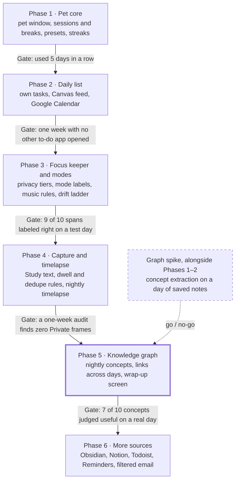

# Roadmap

Phases ship in order, and each gate must pass before the next phase starts. Requirement IDs (P-1, C-5, ...) refer to `spec.md`. Why each tool was chosen is in `DECISIONS.md`.

## Phase 1 · Pet core (done)

**Builds:** the pet window, the panel, the session timer and the streak.

**Features**
- A transparent, always-on-top pet that can be dragged and hidden with one shortcut (P-1).
- Eyes open only while a focus block runs (P-2).
- A panel with Today, Wrap up and Settings (P-3).
- Focus and break lengths per session, with saved presets (S-1).
- Breaks, a call back when the break ends, repeated once after 2 minutes (S-3, S-4).
- A suggestion to take a real break after 3 skipped in a row (S-5).
- Blocks of any length count toward the day (S-6).
- Streak: a day counts at 25 minutes (adjustable), 2 freezes a month, milestones at 7, 30 and 100 days.

**Uses:** Tauri 2 (Rust core), Vite with plain TypeScript, a Python sidecar over JSON lines, SQLite through `rusqlite`, the Tauri global-shortcut plugin, `objc2-app-kit` on macOS for window behavior Tauri does not expose.

**Tasks**
- [x] Scaffold Tauri, Vite and the Python sidecar
- [x] Pet window: transparent, drag, click to open the panel, `Alt+Shift+P` to hide
- [x] Pet on every macOS Space; the panel opens on the current one
- [x] Panel with three views
- [x] Timer state machine and its tests (`backend/timer.py`)
- [x] Presets and finished focus blocks stored in SQLite
- [x] Streak rules and their tests (`backend/streaks.py`)
- [x] Wrap-up view with the last 7 days
- [x] Use it 5 days in a row and write down what breaks -> Pet is working properly for 5 days (*note that can not code while open pet)

**Gate:** used 5 days in a row.

## Graph spike (alongside Phases 1–2)

**Builds:** a throwaway script, not part of the app. It answers one question: are the extracted concepts useful?

**Features:** none for the user. The output is a go / no-go for Phase 5.

**Uses:** a Python script, Ollama or llama.cpp with a small open model, one day of saved study notes as input.

**Tasks**
- [ ] Save one real day of study text (notes, a PDF, two web pages)
- [ ] Extract 5 to 15 concepts per source with the local model
- [ ] Judge 10 concepts by hand: useful or noise
- [ ] Record the result and the model used in `DECISIONS.md`

**Gate:** go / no-go for Phase 5.

## Phase 2 · Daily list (in progress)

**Builds:** the pet's own to-do list, the Today view, and the first two read-only feeds.

**Features**
- Quick add by typing, such as "STAT 310 HW3 Fri 2h"; the pet parses course, due date and estimate.
- Two views: Today and All. Today is built at 7 am or first wake.
- Canvas assignments and calendar events merged into the list, never written back.
- A session can be tied to a task (S-2).
- Typed quick commands, such as "start 50 minutes" (P-4).
- Reminders timed by due date against the estimate, held until the next break.

**Uses:** new `task`, `task_source_link` and `calendar_event` tables in SQLite, the Canvas calendar feed (ICS), Google Calendar's secret iCal address (OAuth is deferred), the `icalendar`, `recurring-ical-events` and `certifi` packages, a separate task-fetcher process that is the only one with network access (PR-6). Feed addresses are in the `setting` table for now, not the OS keychain (PR-4 is not met; see `KNOWN_ISSUES.md`).

**Tasks**
- [x] Task tables and a migration
- [x] Quick-add parser and its tests (`backend/tasks.py`)
- [x] Task list in the panel: add, check off, delete
- [x] Today and All views in the panel (a filter over one list; Today is not yet built at 7 am or stored in `planned_for`)
- [x] ICS feed parser and its tests (`backend/feeds.py`), checked against a real Canvas feed
- [x] Feed storage with the sync rules for done status and removed items (`sync_feed` in `lib.rs`)
- [x] Task fetcher process, separate from the offline sidecar (`backend/fetcher.py`)
- [x] Canvas ICS import with stable source IDs; feed address set in Settings
- [x] Calendar import by Google's secret iCal address; today's events listed in the panel
- [x] Upload an exported .ics file where a calendar has no address
- [x] Pixel-slime pet with closed and open eyes, shown in the panel and as the app icon
- [ ] Look at the new pet in the real window: focus block (eyes open), call back (hop), a milestone star
- [x] Rebuild and reinstall the everyday app so it gets the new pet and icon (done 2026-10-04; do it again after any change it should get, and back up its `pet.db` first)
- [ ] Commit the new pet, icon and docs; the installed app was built from uncommitted files
- [ ] Set the version to 0.2.0 in `package.json`, `Cargo.toml` and both Tauri configs
- [ ] Wake-up splash from the logo design (optional)
- [ ] Try the Google import against a real calendar or export (only a made-up feed so far)
- [ ] Google Calendar by read-only OAuth, so the calendar updates without uploading a file again
- [ ] Feed addresses in the OS keychain (PR-4)
- [ ] Merge a typed task with its imported copy
- [ ] Check off a task when Canvas shows it submitted (needs a Canvas API token)
- [ ] Let the user choose which courses and calendars to import
- [ ] Tie a session to a task; show time spent against the estimate
- [ ] Quick commands
- [ ] Reminders at breaks and the morning brief

**Decided:** `icalendar` with `recurring-ical-events` parses ICS. **To decide:** which library handles OAuth, if it is needed.

**Gate:** one week with no other to-do app opened.

## Phase 3 · Focus keeper and modes

**Builds:** the window monitor, the privacy gate, the mode classifier and the drift ladder. Nothing on screen is stored yet, only app names and time.

**Features**
- Every stretch of time labeled Study, Work, Relax or Private, with 3-minute smoothing.
- Privacy tiers: the pet asks "Can I look at this?" the first time an app or site appears (PR-2).
- A shortcut that makes the pet look away for 15 minutes (PR-3).
- Drift ladder: glance at 30 s, speech bubble at 2 min, sits on the window at 5 min, opt-in block at 10 min.
- Music rules: background audio never changes the mode; the pet wears headphones.
- Personality choice: Gentle, Sassy or Roast.
- The pet offers to start a session when it sees study with none running (S-7).
- Front app, title and URL read every 5 s; capture pauses on breaks and in Relax (C-1 to C-4).

**Uses:** NSWorkspace and the Accessibility API from Rust, a Chrome or Edge extension for the URL and YouTube player state, new `activity_span` and `app_rule` tables, rules only (no model) to stay under 5% CPU.

**Tasks**
- [ ] Window monitor: front app and title every 5 s
- [ ] Browser extension that reports the URL
- [ ] Onboarding that explains each OS permission before asking (PR-10)
- [ ] Privacy gate with default Private apps, running before anything else (PR-1)
- [ ] Mode classifier: declaration, learned rule, app category, context
- [ ] Ask once and remember the answer
- [ ] Drift rules and the four-step ladder
- [ ] Background-audio rules and the 60-second grace period
- [ ] Pet states: Relaxing, Headphones, Nudging, Happy
- [ ] Time balance per mode in the wrap-up view

**To decide:** how the extension talks to the app (native messaging or a local port).

**Gate:** 9 of 10 spans labeled right on a test day.

## Phase 4 · Capture and timelapse

**Builds:** the capture worker, the encrypted store and the nightly timelapse.

**Features**
- Text saved from Study-tier pages and PDFs, with OCR as a fallback (C-5).
- A page counts as studied after 60 s of focus (C-6).
- Text saved only when it changes, checked by hash (C-7).
- Email addresses and phone numbers redacted before saving (C-8).
- A 30-second timelapse of the day's Study windows; raw frames deleted after it renders (PR-5).
- A data panel listing everything stored, with delete per item, per day, or all (PR-8).

**Uses:** ScreenCaptureKit for frames, page text from the browser extension, PyMuPDF for PDFs, Apple Vision OCR, SQLCipher in place of plain SQLite (PR-4), ffmpeg, new `source`, `snapshot` and `frame` tables.

**Tasks**
- [ ] Switch the database to SQLCipher with the key in the keychain, before any text is stored
- [ ] Extension sends page text for Study-tier sites
- [ ] PDF text with PyMuPDF; OCR fallback
- [ ] Dwell rule, content-hash dedupe, redaction, each with tests
- [ ] One low-res frame every 10 s from Study windows only
- [ ] Timelapse built at wrap-up with ffmpeg; frames deleted afterwards
- [ ] Data panel
- [ ] One-week audit of stored frames for the gate

**Gate:** a one-week audit finds zero Private frames.

## Phase 5 · Knowledge graph

**Builds:** the nightly graph job and the full wrap-up screen. Starts only if the graph spike said go.

**Features**
- At wrap-up (or 10 pm), the day's Study text becomes 5 to 15 concepts per source, merged with earlier days.
- A graph with today's concepts highlighted and linked to older ones.
- A 3 to 5 sentence summary of the day.
- Click a concept to list its sources; click a source to reopen it (G-1).
- Rename, merge or delete concepts (G-2); browse by day, course and task (G-3).
- The pet's habitat grows as the graph grows (G-5).

**Uses:** Ollama or llama.cpp with a small open model, run offline once a day (G-4); a local vector index such as sqlite-vec for matching concepts by meaning; new `concept`, `concept_link`, `concept_mention` and `day_summary` tables; a separate process for the graph job so it does not stall the timer.

**Tasks**
- [ ] Move long jobs to their own sidecar process
- [ ] Concept extraction per source
- [ ] Merge with existing concepts by name and by embedding
- [ ] Edges within a source, plus relations the model finds
- [ ] Day summary record and summary text
- [ ] Graph view in the wrap-up screen
- [ ] Concept editing and browsing
- [ ] Habitat growth

**To decide:** the model, and the library that draws the graph.

**Gate:** 7 of 10 concepts judged useful on a real day.

## Phase 6 · More sources

**Builds:** four more read-only task feeds.

**Features**
- Tasks from Obsidian, Notion, Todoist and Apple Reminders.
- Deadlines from email, chosen senders only; the email itself is never stored (PR-7).
- Each source shows its last sync and a "disconnect and delete" button (PR-9).

**Uses:** local markdown files for Obsidian, read-only APIs for Notion, Todoist and Reminders, the local model from Phase 5 to pull deadlines out of email, the task fetcher from Phase 2.

**Tasks**
- [ ] Obsidian: read tasks from local markdown
- [ ] Notion, Todoist and Reminders importers
- [ ] Email: sender allowlist, deadline extraction, store only the task
- [ ] Per-source sync status and disconnect
- [ ] Check duplicate merging across all sources

**Note:** distributing the app publicly with Gmail access needs Google's restricted-scope security review (PR-12).

**Gate:** duplicate tasks merged correctly.
