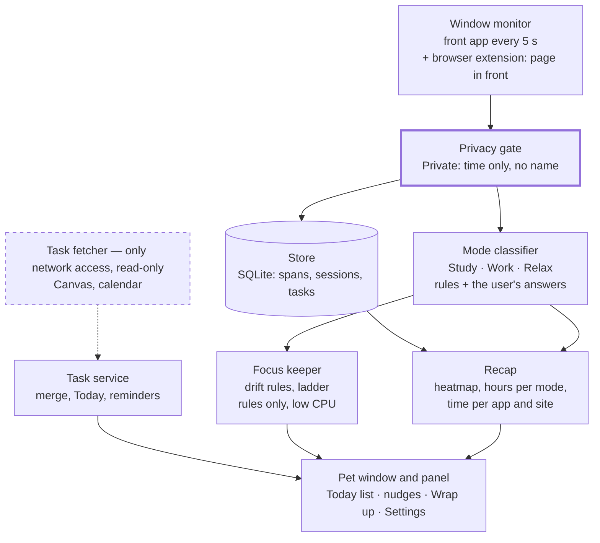

# Study Pet — Product Spec

Oct 11, 2026 · @vic

## Overview

Study Pet is a desktop pet that runs locally on a laptop. It keeps a student focused, merges every to-do source into one daily list, and shows where each day went.

**Goals**

- Keep focus during study without shaming the user.
- Replace scattered task apps with one daily list.
- Tell study, work and relaxing time apart automatically.
- Show where the day went: hours of focus, hours per mode, and time per app and site.
- Stay simple. A new feature is added only when daily use asks for it.
- Keep everything the pet notes on the laptop.

**Non-goals**

- No knowledge graph, timelapse or reading of what is on screen. The pet keeps names and times, never content (dropped on 2026-10-11; see "What changed").
- No cloud sync, accounts or multiple devices.
- No social features or shared streaks.
- No write-back to Canvas, calendars or notes apps.
- No webcam, microphone or keystroke logging.
- No mobile app.

**What changed on 2026-10-11**

The end-of-day knowledge graph, the timelapse and the content capture that fed them were removed: they did not fit how the pet is used day to day. The more-sources phase and database encryption moved to "Maybe later". The recap views in "Wrap up and recap" were added. Requirement IDs are not reused: C-5 to C-8, G-1 to G-5, PR-5, PR-7 and PR-12 are gone.

## Target user and problems

The first user is a university student who studies in short, scattered sessions on a laptop and tracks tasks in several places.

| Problem | What happens today | What the pet does |
| --- | --- | --- |
| Tasks live in four or more places | Canvas, calendar, professor emails, notes apps | Merges them into one read-only daily list |
| Drift into doomscrolling | Blockers feel punishing and get switched off | Nudges with humor and rewards coming back |
| Study, work and rest blur together | No record of where the day went | Labels time automatically and shows the day's balance |
| Can't say where the day went | Time is spread across apps and tabs | One total per app and site, for any day |
| Motivation fades | Streak apps reset after one missed day | Uses forgiving streaks, a heatmap of study and work, and a pet that grows |

## A day with the pet

A typical day touches every feature once.

1. **Morning:** the pet shows Today. It lists classes from the calendar, a Canvas assignment due Friday, a task added last night and one leftover.
2. **First hour:** the user opens the STAT 310 homework. Nothing is started. After 5 minutes of study the pet opens its eyes.
3. **Studying:** Spotify plays in the background, so the pet wears headphones.
4. **Drift:** the user opens Reels. The pet glances, then speaks, then sits in the middle of the screen. The user comes back and the pet perks up.
5. **Break:** after 50 minutes the pet suggests a break. The user steps away, and the pet stops watching until they are back at work.
6. **Afternoon:** 30 minutes of study between classes, then an hour of internship applications labeled Work.
7. **Evening:** a show plays. The pet lies down and stays quiet.
8. **Wrap-up:** the user opens Wrap up. It shows the heatmap of study and work, the day's hours of Study, Work and Relax, the time in each app and site, and the streak. A click on yesterday in the heatmap shows yesterday instead.

## Pet, sessions and breaks

The pet is an always-on-top character whose eyes always show whether it is watching. Its states are Idle, Watching, Relaxing, Headphones, Nudging and Happy.

| ID | Requirement | Status |
| --- | --- | --- |
| P-1 | The pet lives in a transparent, always-on-top window. The user can drag it anywhere and hide it with one shortcut. | Built |
| P-2 | Eyes are open only while the focus keeper is on and the pet is watching, and closed in every other state. | Built |
| P-3 | Clicking the pet opens a panel: Today list, wrap up, settings. | Built |
| P-4 | The user can type quick commands, such as "start 50 minutes" or "I'm relaxing." | Maybe later |
| S-1 | The user sets focus and break length per session, with saved presets such as 25/5 and 50/10. | Removed 2026-10-13: replaced by automatic recording |
| S-2 | A session can be tied to a task from the list, or left untagged. | Removed 2026-10-13: replaced by automatic recording |
| S-3 | Breaks pause noting and nudges automatically. | Removed 2026-10-13: replaced by automatic recording |
| S-4 | When a break ends, the pet calls the user back, and repeats once after 2 minutes. | Removed 2026-10-13: replaced by automatic recording |
| S-5 | After 3 skipped breaks in a row, the pet suggests a real break. | Removed 2026-10-13: replaced by automatic recording |
| S-6 | All Study and Work time counts toward the day. There is no minimum stretch. | Built |
| S-7 | If study is detected with no session running, the pet offers to start one. | Removed 2026-10-13: replaced by automatic recording |
| S-8 | The pet counts Study and Work time by itself, from the labels in "Activity modes". There is nothing to start. | Built |
| S-9 | After a run of study or work (50 minutes by default, set in Settings, 0 for never), the pet suggests a break once, with a sound. | Built |

## Activity modes and background audio

Every stretch of time gets one label: Study, Work, Relax or Private. The label is judged by the app or site in front, never by what is playing.

**Detection signals, strongest first**

1. The user's own declaration, such as "Right now I'm relaxing." This always wins.
2. A learned rule for this app or site from an earlier answer.
3. The app or site category. Canvas means Study; Steam means Relax.

An app or site with none of these has no mode, and its time is "unknown" until the user answers. (Until 2026-10-13 an unknown app inside a focus block was taken as Study; that still holds for the recap of an earlier day.)

**Labeling rules**

- A label changes only after about 3 minutes of sustained activity. Short detours keep the current label.
- When unsure, the pet asks once and remembers the answer.
- Private apps and sites are counted as "Private" time, without their names.

|  | Study | Work | Relax | Private |
| --- | --- | --- | --- | --- |
| Pet behavior | Focused, watching | Busy, supportive | Lies down, quiet | Eyes closed |
| Turns the focus keeper on | Yes | Yes | No | No |
| What is kept | Name and time | Name and time | Name and time | Time only |
| Counts toward streak | Yes | Yes | No | No |

**Background audio**

- Music apps and sites such as Spotify, Apple Music, SoundCloud and YouTube Music are background-only. They never change the mode and the pet never asks about them.
- In front while the focus keeper is on, a music app or site has a 60-second grace period, for example to skip a song. After that it counts as drift.
- The pet logs only that sound was on, never what was playing. It wears headphones while sound plays.

## What the pet notes

The pet checks the front app every 5 seconds and keeps its name and the time. For a page in Chrome the user said yes to, the extension also sends the page's address and title. Nothing on screen is ever read or stored.

| ID | Requirement | Status |
| --- | --- | --- |
| C-1 | Every 5 s, note the front app, plus the page in front from the browser extension. The window title is not read. | Built |
| C-2 | The privacy gate runs first. A Private app, site or window is counted as "Private" time with no name. | Built |
| C-3 | An app or site nobody has answered for is noted by name and time only, and asked about once. | Built |
| C-4 | Noting pauses when the pet is told to look away, and after 5 minutes with nobody at the keyboard. | Built |

## Wrap up and recap

The Wrap up view answers "where did the day go?" for today or any earlier day. Everything in it is worked out from what the pet already notes; nothing new is recorded.

| ID | Requirement | Status |
| --- | --- | --- |
| R-1 | **Heatmap.** A grid of days covering about the last four months, each day shaded by its hours of Study and Work: none, under 1 h, 1 to 2 h, 2 to 4 h, 4 h or more. A day with more Study is blue and one with more Work is orange; a tie is blue. Hovering a day shows its date, hours and larger mode. It replaces the "Last 7 days" strip. | Built |
| R-2 | **Any day.** Clicking a day in the heatmap shows that day's recap (R-3 and R-4) in place of today's. Today is shown when the view opens, and one click goes back to it. | Built |
| R-3 | **Recap by mode.** One bar split into Study, Work, Relax, Private and unknown time, with the hours of each beside it. | Built |
| R-4 | **One list of apps and sites.** A single total per app and per site for the day, longest first. The browser's own row counts only the time not already listed under a site, so no time is counted twice. The list of stretches with times of day is removed. | Built |
| R-5 | **Names, not addresses.** A site is shown by name everywhere in the panel and in the pet's questions: "YouTube", never `www.youtube.com`. A built-in list names common sites; any other site gets a name worked out from its address (`canvas.auckland.ac.nz` becomes "Canvas"). Apps are shown by the name the Dock shows. | Built |
| R-6 | **A folding "What the pet has learned".** The section in Settings is closed by default and shows how many answers it holds; a click opens and closes it. | Built |

**Limits that are accepted**

- Labels are worked out when a day is shown, with the rules as they are now. An answer given today also relabels earlier days.
- Apps and sites have been noted since 2026-10-07, so an earlier day has focus hours in the heatmap and an empty recap.
- A site the user said no to in the extension is not noted, so its time shows under the browser's own row.
- A name worked out from an address can be clumsy for an obscure site. The fix is to add that site to the built-in list.
- Two addresses of one site are one row ("YouTube" for `www.youtube.com` and `m.youtube.com`), and so are two different sites that are given the same name.
- An app or site in front for under a minute in a day is left off the list, so the list can add up to a little less than the bar.
- The pet's drift lines name the site too. The Chrome extension's own popup still lists sites by address, since that is where answers are managed per site.

## Streaks

The streak counts days with at least 25 minutes of Study and Work, as the pet recorded them.

- A day counts at 25 minutes of Study and Work or more. The threshold is adjustable.
- Days before 2026-10-13 keep the minutes of their focus blocks.
- Two streak freezes a month protect against one bad day.
- The pet changes at streak milestones: 7, 30 and 100 days.

## Focus keeper

The keeper turns itself on after 5 minutes of Study or Work. While it is on, the pet notices drift and escalates gently. It turns off after 15 minutes of Relax in a row, after 5 minutes away from the laptop, and when the user says they are relaxing. It never shames the user, and it is silent while it is off.

**What counts as drift**

- A Relax app or site in front, by the built-in list or by the user's answer, after a 30-second grace period.
- YouTube's home page, feeds and Shorts. A YouTube video is not drift.
- A music app or site left in front past its 60-second grace period.
- Unknown apps are asked about once, and the user's answer decides.

| Step | After | What the pet does |
| --- | --- | --- |
| 1 | 30 s of drift | Glances at the user |
| 2 | 2 min | Speech bubble about the time and the site |
| 3 | 5 min | Moves to the middle of the screen and sits there |
| 4 | 10 min, opt-in only | Blocks the site for 5 minutes (Chrome only) |

**Tone rules**

- The user picks a personality: Gentle, Sassy or Roast.
- Lines mention time and the site. They never comment on the user's worth, intelligence or appearance.
- Coming back is always rewarded: the pet celebrates the return.

## Daily to-do list and integrations

The pet owns one to-do list. Other apps are read-only feeds, and nothing is ever written back to them.

**Tasks**

- Quick add by typing, such as "STAT 310 HW3 Fri 2h." The pet parses the course, due date and estimate.
- Each task has a title, course, due date, estimate, sources and status.
- There are only two views: Today and All.

**The Today list** holds:

- Anything due today, and anything overdue.
- Tasks due soon compared with their estimate.
- Tasks the user added for today, and unfinished ones from yesterday.
- Calendar events, shown as a timeline without checkboxes.

| Source | How it is read | Status |
| --- | --- | --- |
| The pet's own tasks | Native | Built |
| Canvas | Calendar feed (ICS). No API token: the school does not give students one, so submission status is not read; the pet asks instead (see the sync rules) | Built |
| Google Calendar | Read-only sign-in (OAuth), the calendar's secret iCal address, or an exported .ics file uploaded by hand | Built |
| Obsidian, Notion, Todoist, Apple Reminders, email | Not planned | Maybe later |

**Sync rules** (where the build falls short is in `KNOWN_ISSUES.md`)

- Every imported item keeps a stable source ID, so a re-sync never brings back a checked task.
- A source edit, such as a new due date, updates the pet's copy and keeps its done status.
- An item deleted at the source is flagged "removed from Canvas" instead of vanishing.
- The Canvas feed carries no submission status. So for a Canvas task the pet asks, once after its due time and never while the focus keeper is on ("Did you submit it?"); a yes checks it off, and it can always be checked off by hand.
- A typed task and its imported copy merge when the user confirms the pet's suggestion.
- The user chooses which courses to show.

**Reminders**

- Timed by due date against the estimate, not by fixed alarms.
- A reminder waits while the focus keeper is on.

## Privacy and security

What the pet notes never leaves the laptop. The only network traffic is read-only task fetching, and Private apps are never named.

| Tier | What the pet keeps | Default for |
| --- | --- | --- |
| Noted | App name and time; for an allowed page, its address, title and time | Apps in front, and sites the user said yes to |
| Private | Only "private time, N minutes" | Password managers, banking, messaging, email clients, incognito windows, any screen with a password field, and anything the user marks Private |

| ID | Requirement |
| --- | --- |
| PR-1 | The gate runs before anything is stored. A Private window is never named, rather than named and then deleted. |
| PR-2 | The first time a site appears, the extension asks "Can I look at this?" and saves the answer. An app or site the pet cannot place is asked about once. |
| PR-3 | Eyes open means watching. One global shortcut makes the pet look away for 15 minutes. |
| PR-4 | Tokens and feed addresses live in the OS keychain. Encrypting the database itself is "Maybe later". |
| PR-6 | The task fetcher is a separate process and the only one with network access. |
| PR-8 | A data panel that lists everything stored, with delete per day or all. Maybe later. |
| PR-9 | Each source shows its last sync and a "disconnect" button. |
| PR-10 | Settings explains each OS permission before asking for it. |
| PR-11 | Sound is logged as on or off, never what was playing. |

## System architecture

The privacy gate sits at the start of the path, so a Private window is never named in the store. The task fetcher is the only process allowed on the network.

| Part | Built with (macOS) |
| --- | --- |
| Pet window and panel | Tauri app (Rust core, web UI), transparent and always on top |
| Window monitor | NSWorkspace; the Accessibility API only to see whether a password field has the keyboard |
| Browser data | Chrome extension: the address and title of an allowed page, and whether a tab is playing sound |
| Store | SQLite |
| Rules (timer, streak, modes, drift) | A Python sidecar process with no network access |
| Task fetcher | A second Python process, run on a schedule |

## Data model

Ten record types cover the whole product, all stored in one local database.

| Record | Key fields | Notes |
| --- | --- | --- |
| Session | start, end, planned length, break length, task | One per focus block, from before 2026-10-13. None is added now |
| Day total | day, Study seconds, Work seconds | One per finished day since 2026-10-13; rebuilt when an app rule changes |
| App span | start, end, app name, bundle ID | The app in front; "Private" with no name for a Private app |
| Activity span | start, end, site, address, title | An allowed page in front in Chrome |
| Audio span | start, end | That sound was on, never what |
| Mode declaration | start, end, mode | "Right now I'm relaxing" |
| App rule | app or site, name, mode | The user's answers: Study, Work, Relax or Private |
| Task | title, course, due time or due date, estimate, status, done time, last reminded | Owned by the pet |
| Task source link | task, source app, source item ID, last sync, removed flag | Drives sync and merging |
| Calendar event | source, source item ID, title, start, end, all-day flag | Not a task: no done state, never merged |

Mode labels and recap totals are not stored. They are worked out from the spans each time a day is shown.

## Non-functional requirements

The pet has to be light enough to leave open all day on battery. Everything runs on rules; there is no model.

| Area | Target |
| --- | --- |
| CPU while studying | Under 5% average on a recent laptop |
| Memory | Under 300 MB |
| Wrap up | Any day's recap shown within a second |
| Startup | Pet visible within 3 s of login |
| Crash recovery | At most the last minute of activity is lost |
| Network | Zero outbound traffic except the task fetcher |

## Roadmap

Phases 1 to 4 are built. Phases 1 to 3 are in daily use; the recap of Phase 4 was built on 2026-10-11 and reaches the installed app at its next reinstall. There are no more phases and no gates: the app stays as it is, and small extras are added one at a time when daily use asks for them. The task list is in `ROADMAP.md`.

| | What | Status |
| --- | --- | --- |
| 1 · Pet core | Pet window, sessions and breaks, presets, streaks | Built |
| 2 · Daily list | Own tasks, quick add, Today and All views, Canvas feed, Google Calendar | Built |
| 3 · Focus keeper and modes | Privacy gate, mode labels, music rules, drift ladder | Built |
| 4 · Recap | Heatmap, recap by mode for any day, one list of apps and sites, names for sites, folding learned section (R-1 to R-6) | Built |
| Maybe later | Quick commands, morning brief, more task sources, database encryption, a data panel, Windows | Only if needed |

## Success metrics

Success means the first user keeps the pet open every day and trusts what it shows.

| Metric | Target |
| --- | --- |
| Days the pet is opened | 6 of 7 |
| Days per week that count toward the streak | 5 or more |
| Returns within 2 minutes of a nudge | 60% or more |
| Activity labels correct in a spot check | 90% or more |
| Other to-do apps opened per week | Close to zero |
| Private apps or sites named in the store | Zero, always |

## Open decisions and risks

**Open decisions**

- [x] Platform first: macOS. Windows is "Maybe later".
- [x] Knowledge graph and timelapse: dropped on 2026-10-11.
- [x] Should Work time count toward the streak? Yes, since 2026-10-13: Study and Work both count.
- [ ] The pet's name.

| Risk | Impact | Mitigation |
| --- | --- | --- |
| Activities are mislabeled | Nudges during real study erode trust; the recap reads wrong | 3-minute smoothing, ask once, user declarations win |
| It feels like surveillance | The user turns it off | Visible eyes, ask-first sites, names and times only |
| CPU or battery drain | The pet gets closed on battery | Rules only, no model |
| The database is not encrypted | Page addresses and titles are readable by other programs run by the user | Only allowed sites are noted; a Private answer deletes a site's pages; encryption is "Maybe later" |
| School disables Canvas tokens (it has, as of 2026-10-05) | No submission status | The ICS feed is the baseline; the pet asks whether work was submitted |
| Scope creep | The app stops being simple | No phases; one small extra at a time, only when daily use asks for it |
