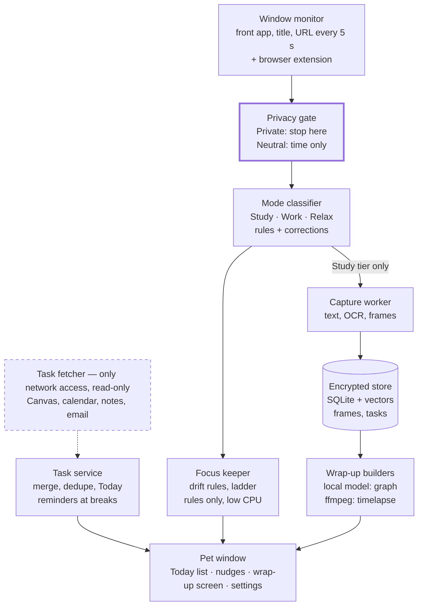
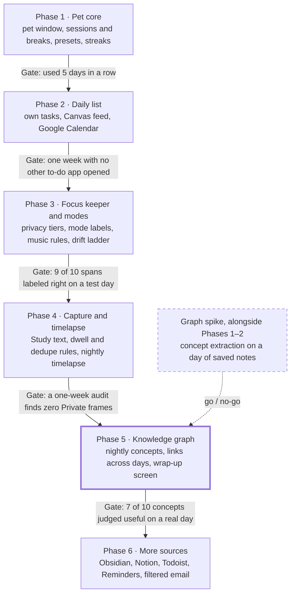

# Study Pet — Product Spec

Oct 1, 2026 · @vic

## Overview

Study Pet is a desktop pet that runs locally on a laptop. It keeps a student focused, merges every to-do source into one daily list, and turns each day's study into a growing knowledge graph.

**Goals**

- Show what was learned each day, across many short sessions, as a graph that links to earlier days.
- Keep focus during study without shaming the user.
- Replace scattered task apps with one daily list.
- Tell study, work and relaxing time apart automatically.
- Keep every captured byte on the laptop.

**Non-goals for v1**

- No cloud sync, accounts or multiple devices.
- No social features or shared streaks.
- No write-back to Canvas, calendars or notes apps.
- No webcam, microphone or keystroke logging.
- No mobile app.

## Target user and problems

The first user is a university student who studies in short, scattered sessions on a laptop and tracks tasks in several places.

| Problem | What happens today | What the pet does |
| --- | --- | --- |
| Can't say what was learned today | Material is spread across tabs, PDFs and lectures | Builds an end-of-day knowledge graph linked to sources |
| Tasks live in four or more places | Canvas, calendar, professor emails, notes apps | Merges them into one read-only daily list |
| Drift into doomscrolling | Blockers feel punishing and get switched off | Nudges with humor and rewards coming back |
| Study, work and rest blur together | No record of where the day went | Labels time automatically and shows the day's balance |
| Motivation fades | Streak apps reset after one missed day | Uses forgiving streaks and a pet that grows |

## A day with the pet

A typical day touches every feature once.

1. **Morning:** the pet shows Today. It lists classes from the calendar, a Canvas assignment due Friday, a task added last night and one leftover.
2. **First session:** the user picks "STAT 310 HW3," sets 50 minutes, and the pet opens its eyes.
3. **Studying:** a PDF and two web pages count as studied. Spotify plays in the background, so the pet wears headphones.
4. **Drift:** the user opens Reels. The pet glances, then speaks, then sits on the window. The user comes back and the pet perks up.
5. **Break:** capture pauses and queued reminders appear. The pet says to stand up, then calls the user back when the break ends.
6. **Afternoon:** a 30-minute session between classes, then an hour of internship applications logged as Work.
7. **Evening:** a show plays. The pet lies down and stays quiet.
8. **Wrap-up:** the user taps "wrap up my day." The pet shows the knowledge graph, a 30-second timelapse, the day's time balance and the streak.

## Pet, sessions and breaks

The pet is an always-on-top character whose eyes always show whether it is watching. Its states are Idle, Watching, Break, Relaxing, Headphones, Nudging, Happy and Sleeping.

| ID | Requirement | Phase |
| --- | --- | --- |
| P-1 | The pet lives in a transparent, always-on-top window. The user can drag it anywhere and hide it with one shortcut. | 1 |
| P-2 | Eyes are open only while capture is active, and closed in every other state. | 1 |
| P-3 | Clicking the pet opens a panel: Today list, start session, wrap up day, settings. | 1 |
| P-4 | The user can type quick commands, such as "start 50 minutes" or "I'm relaxing." Voice comes later. | 2 |
| S-1 | The user sets focus and break length per session, with saved presets such as 25/5 and 50/10. | 1 |
| S-2 | A session can be tied to a task from the list, or left untagged. | 2 |
| S-3 | Breaks pause capture and nudges automatically. | 1 |
| S-4 | When a break ends, the pet calls the user back, and repeats once after 2 minutes. | 1 |
| S-5 | After 3 skipped breaks in a row, the pet suggests a real break. | 1 |
| S-6 | Sessions of any length count toward the day. There is no per-session minimum. | 1 |
| S-7 | If study is detected with no session running, the pet offers to start one. | 3 |

## Activity modes and background audio

Every stretch of time gets one label: Study, Work, Relax or Private. The label is judged by the window in front, never by what is playing.

**Detection signals, strongest first**

1. The user's own declaration, such as "I'm relaxing." This always wins.
2. A learned rule for this app, site or document from an earlier correction.
3. The app or domain category. Canvas means Study; Steam means Relax.
4. On-screen content for ambiguous apps. A YouTube lecture differs from a vlog; lecture notes differ from a cover letter.
5. Context: a running session, a tagged task or a calendar class.

**Labeling rules**

- A label changes only after about 3 minutes of sustained activity. Short detours keep the current label.
- When unsure, the pet asks once and remembers the answer.
- Private apps are labeled by app name only. Their content is never read.

|  | Study | Work | Relax | Private |
| --- | --- | --- | --- | --- |
| Pet behavior | Focused, watching | Busy, supportive | Lies down, quiet | Eyes closed |
| Focus keeper | On | On | Off | Off |
| Content recorded | Text and frames, allowed apps only | Time and page titles | Time only | Time only |
| Knowledge graph | Yes | No | No | No |
| Timelapse | Yes | Optional | No | No |
| Counts toward streak | Yes | No by default | No | No |

Work has its own log instead of the graph, such as "applied to 3 internships, 1 h 20 min."

**Background audio**

- Music apps such as Spotify, Apple Music and SoundCloud are tagged background-only. They never change the mode.
- A YouTube tab behind the front window counts as background audio.
- Bringing the music tab forward for under 60 seconds, for example to skip a song, is a grace period.
- Listening becomes drift when the tab stays in front past 60 seconds, or the user opens recommendations, comments or Shorts.
- Saved study playlists launch from the pet straight to the playlist, so the user never lands on the YouTube homepage.
- The pet logs only that audio was on, never titles. It wears headphones while music plays.

## Capture and recording

The pet checks the front window every 5 seconds and stores content only from Study-tier apps the user allowed. The privacy gate runs before anything is captured.

| ID | Requirement | Phase |
| --- | --- | --- |
| C-1 | Every 5 s, read the front app and window title, plus the URL from the browser extension. | 3 |
| C-2 | The privacy gate checks the tier first. A Private window is never captured. | 3 |
| C-3 | Neutral tier: log the app name and duration only. | 3 |
| C-4 | Capture pauses during breaks, in Relax mode, and when the pet is told to look away. | 3 |
| C-5 | Study tier: extract text (web page text, PDF text, OCR as a fallback) and save a low-res frame for the timelapse. | 4 |
| C-6 | A page counts as studied after 60 s of focus. Shorter visits are dropped. | 4 |
| C-7 | Text is saved only when content changes, checked by hash, so a long PDF isn't stored over and over. | 4 |
| C-8 | Email addresses and phone numbers are redacted before text is saved. Chat apps are never Study tier by default. | 4 |

## End-of-day knowledge graph

At wrap-up, a local model turns the day's study text into concepts and links them to each other and to earlier days. The graph is built once a day, not per session, so short sessions still add up.

**How a wrap-up runs**

1. The user taps "wrap up my day," or a set time arrives (default 10 pm).
2. All Study text captured today is collected, grouped by source.
3. The model extracts 5 to 15 key concepts per source.
4. Concepts that match ones already in the graph, by name or close meaning, are merged.
5. Edges are added between concepts from the same source, plus relations the model finds, such as "backprop uses the chain rule."
6. Each concept is linked to its sources, timestamps and tagged task.

**The wrap-up screen shows**

- The graph, with today's new concepts highlighted and linked to older ones.
- A 3 to 5 sentence summary of what was studied.
- The day's time balance across Study, Work, Relax and Private.
- Time spent per task, against the estimate.
- The timelapse and the streak.

| ID | Requirement | Phase |
| --- | --- | --- |
| G-1 | Clicking a concept lists its sources. Clicking a source reopens the page or file. | 5 |
| G-2 | The user can rename, merge or delete concepts, and edits persist. | 5 |
| G-3 | The graph can be browsed by day, course and task. | 5 |
| G-4 | Graph building runs offline once a day and may take several minutes. | 5 |
| G-5 | The pet's habitat grows visibly as the graph grows. | 5 |

## Timelapse and streaks

The timelapse is a 30-second video of the day's Study windows. The streak counts days with at least 25 minutes of Study time.

**Timelapse**

- One low-res frame every 10 s, from Study windows only.
- Private and Neutral windows are skipped or shown as a blurred placeholder tile.
- Built at wrap-up. Raw frames are deleted once the video is rendered.
- Videos are kept 30 days by default, adjustable in settings.

**Streaks**

- A day counts at 25 minutes of Study time or more. The threshold is adjustable.
- Two streak freezes a month protect against one bad day.
- Work time does not count by default (see open decisions).
- The pet changes at streak milestones: 7, 30 and 100 days.

## Focus keeper

During Study and Work time, the pet notices drift and escalates gently. It never shames the user, and it goes silent in Relax mode.

**What counts as drift**

- A denylisted app or site in front during Study or Work, after a 30-second grace period.
- Feed patterns: Shorts, Reels, homepage feeds and endless scrolling.
- A music tab left in front past its 60-second grace period.
- Lecture content on YouTube is not drift.
- Unknown apps are classified once, and the user confirms.

| Step | After | What the pet does |
| --- | --- | --- |
| 1 | 30 s of drift | Glances at the user |
| 2 | 2 min | Speech bubble with a fact: "Your graph hasn't grown since 2:15." |
| 3 | 5 min | Walks onto the distracting window and sits on it |
| 4 | 10 min, opt-in only | Blocks the site for 5 minutes |

**Tone rules**

- The user picks a personality: Gentle, Sassy or Roast.
- Lines mention time, the task or the graph. They never comment on the user's worth, intelligence or appearance.
- Coming back is always rewarded: the pet celebrates the return.
- After 4 hours of study, the pet suggests relaxing.
- An optional relax limit ("check on me after 2 hours") is off by default.

## Daily to-do list and integrations

The pet owns one to-do list. Other apps are read-only feeds, and nothing is ever written back to them.

**Tasks**

- Quick add by typing, such as "STAT 310 HW3 Fri 2h." The pet parses the course, due date and estimate.
- Each task has a title, course, due date, estimate, sources and status.
- There are only two views: Today and All.

**The Today list**, built each morning at 7 am or first wake, holds:

- Anything due today, and anything overdue.
- Tasks due soon compared with their estimate.
- Tasks the user added for today, and unfinished ones from yesterday.
- Calendar events, shown as a timeline without checkboxes.

| Source | How it is read | Phase |
| --- | --- | --- |
| The pet's own tasks | Native | 2 |
| Canvas | Calendar feed (ICS). No API token: the school does not give students one, so submission status is not read; the pet asks instead (see the sync rules) | 2 |
| Google Calendar or Outlook | OAuth, read-only. Until that is built: the calendar's secret iCal address, or an exported .ics file uploaded by hand | 2 |
| Obsidian | Local markdown files | 6 |
| Notion, Todoist, Apple Reminders | Read-only API | 6 |
| Email | Chosen senders only; a local model extracts deadlines; the email itself is not stored | 6 |

**Sync rules** (which of these are built, and where the build falls short, is in `KNOWN_ISSUES.md`)

- Every imported item keeps a stable source ID, so a re-sync never brings back a checked task.
- A source edit, such as a new due date, updates the pet's copy and keeps its done status.
- An item deleted at the source is flagged "removed from Canvas" instead of vanishing.
- If the source shows the item complete, the pet checks it off. No current source does: the Canvas feed carries no submission status. So for a Canvas task the pet asks, once at the first break after its due time ("Did you submit it?") and when a focus block tied to it ends ("Finished it?"); a yes checks it off, and it can always be checked off by hand.
- Duplicates merge on course, fuzzy title and due date. The merged task shows a badge per source.
- The user chooses which calendars, courses, lists or tags to import.

**Reminders**

- Timed by due date against the estimate, not by fixed alarms.
- Held until the next break, unless the task is due within 2 hours.
- A morning brief lists classes, what is due soon and suggested study blocks in calendar gaps.
- Over time, the pet compares estimates with actual time per kind of task.

## Privacy and security

Captured data never leaves the laptop. The only network traffic is read-only task fetching, and Private apps are never captured at all.

| Tier | What the pet keeps | Default for |
| --- | --- | --- |
| Study | Text, low-res frames, time | Apps and sites the user allows |
| Neutral | App name and time only | Any new app or site until the user decides |
| Private | Only "private time, N minutes" | Password managers, banking, messaging, email clients, incognito windows, any screen with a password field |

| ID | Requirement |
| --- | --- |
| PR-1 | The gate runs before capture. A Private window is never screenshotted, rather than captured and then deleted. |
| PR-2 | The first time an app or site appears, the pet asks "Can I look at this?" and saves the answer. |
| PR-3 | Eyes open means watching. One global shortcut makes the pet look away for 15 minutes. |
| PR-4 | All stored data is encrypted at rest. Tokens live in the OS keychain. |
| PR-5 | Raw frames are deleted after the timelapse. Text and the graph stay until the user deletes them; retention is adjustable. |
| PR-6 | The task fetcher is a separate process with network access. The capture and graph processes have none. |
| PR-7 | Integrations use read-only scopes. Email reads chosen senders only and stores only extracted tasks. |
| PR-8 | A data panel shows everything stored by day and source, with delete per item, per day, or all. |
| PR-9 | Each source shows its last sync and a "disconnect and delete" button. |
| PR-10 | Onboarding explains each OS permission, such as screen recording and accessibility, before asking for it. |
| PR-11 | Background music is logged as "audio on," with no titles. |
| PR-12 | If the app is ever distributed publicly, Gmail access needs Google's restricted-scope security review. |

## System architecture

The privacy gate sits at the start of the capture path, so a Private window never reaches the capture worker. The task fetcher is the only process allowed on the network.

| Part | First build (macOS) | Windows later |
| --- | --- | --- |
| Pet window | Tauri app (Rust core, web UI), transparent and always on top | Same |
| Window monitor | NSWorkspace and the Accessibility API | UI Automation |
| Browser data | Chrome or Edge extension: URL, page text, YouTube player state | Same |
| Screen frames | ScreenCaptureKit | Windows Graphics Capture |
| Text extraction | Page text from the extension, PyMuPDF for PDFs, Apple Vision OCR as a fallback | Windows OCR |
| Store | SQLite encrypted with SQLCipher, plus a local vector index such as sqlite-vec | Same |
| Local model | Ollama or llama.cpp with a small open model, run only at wrap-up | Same |
| Timelapse | ffmpeg | Same |
| Extraction and graph jobs | A Python sidecar process with no network access | Same |

## Data model

Thirteen record types cover the whole product, all stored in one encrypted local database.

| Record | Key fields | Notes |
| --- | --- | --- |
| Session | start, end, planned length, task, mode | One per focus block |
| Activity span | start, end, app, domain, title, mode, tier, label source | Label source: declared, learned, rule or model |
| Source | type, URL or path, title, first seen, dwell time | Web page, PDF, doc or video; Study tier only |
| Snapshot | source, time, text, content hash | Text saved after redaction |
| Frame | time, file path | Deleted after the timelapse |
| Concept | name, aliases, first seen, embedding | A graph node |
| Concept link | two concepts, relation, sources | A graph edge |
| Concept mention | concept, source, time, task | Ties a node to where it was learned |
| Task | title, course, due time or due date, estimate, status, done time, planned day, last reminded | Owned by the pet |
| Task source link | task, source app, source item ID, last sync, removed flag | Drives dedupe and sync |
| Calendar event | source, source item ID, title, start, end, all-day flag | Not a task: no done state, never merged |
| App rule | app or domain, tier, default mode, background-audio flag, set by | Privacy and mode rules |
| Day summary | date, minutes per mode, streak counted, summary text, timelapse | One per wrap-up |

## Non-functional requirements

The pet has to be light enough to leave open all day on battery. Real-time work uses rules only, and the model runs once at wrap-up.

| Area | Target |
| --- | --- |
| CPU while studying | Under 5% average on a recent laptop |
| Memory | Under 300 MB, not counting the nightly model run |
| Wrap-up time | Graph and timelapse ready within 5 minutes for a 6-hour study day |
| Storage | Under 500 MB a month with default retention |
| Startup | Pet visible within 3 s of login |
| Crash recovery | At most the last minute of activity is lost |
| Network | Zero outbound traffic from the capture and graph processes |
| Battery | The model runs only at wrap-up, preferably on power |

## Roadmap and gates

| Phase | Ships | Gate to move on |
| --- | --- | --- |
| 1 · Pet core | Pet window, sessions and breaks, presets, streaks | Used 5 days in a row |
| 2 · Daily list | Own tasks, quick add, Today and All views, Canvas feed, Google Calendar | One week with no other to-do app opened |
| 3 · Focus keeper and modes | Privacy tiers, mode labels, music rules, drift ladder | 9 of 10 spans labeled right on a test day |
| 4 · Capture and timelapse | Study text with dwell and dedupe rules, nightly timelapse | A one-week audit finds zero Private frames |
| 5 · Knowledge graph | Nightly concepts, links across days, wrap-up screen | 7 of 10 concepts judged useful on a real day |
| 6 · More sources | Obsidian, Notion, Todoist, Reminders, filtered email | Duplicate tasks merged correctly |
| Graph spike (parallel to 1–2) | Concept extraction tested on saved notes | Go / no-go for Phase 5 |

Phases ship in order, and each gate must pass before the next phase starts. The graph spike runs alongside Phases 1 and 2, so a noisy graph is caught before capture is built.

## Success metrics

Success means the first user keeps the pet open every day and trusts its graph. These targets cover the first four weeks of personal use.

| Metric | Target |
| --- | --- |
| Days the pet is opened | 6 of 7 |
| Focus sessions per week | 10 or more |
| Returns within 2 minutes of a nudge | 60% or more |
| Wrap-ups opened | 5 of 7 days |
| Concepts judged useful in a weekly review | 7 of 10 |
| Activity labels correct in a spot check | 90% or more |
| Other to-do apps opened per week | Close to zero |
| Private frames captured | Zero, always |

## Open decisions and risks

Six decisions are still open. The biggest risk is a noisy graph, which is why it gets tested early.

**Open decisions**

- [ ] Platform first: this spec assumes macOS, with Windows later.
- [ ] Should Work time count toward the streak? The default is no.
- [ ] Do lecture videos count as study, through captions or transcripts?
- [ ] Handwritten or iPad notes: import photos, or leave them out?
- [ ] What should the graph unlock next: quizzes, spaced review, or both?
- [ ] The pet's look and name.

| Risk | Impact | Mitigation |
| --- | --- | --- |
| The graph is noisy | The product loses its hook | A graph spike on saved notes before Phase 4; users can merge and delete concepts |
| Activities are mislabeled | Nudges during real study erode trust | 3-minute smoothing, ask once, user declarations win |
| It feels like surveillance | The user turns it off | Visible eyes, ask-first tiers, a full data panel |
| CPU or battery drain | The pet gets closed on battery | Rules in real time; the model only at wrap-up |
| OS permission friction | Setup is abandoned | Plain onboarding for each permission |
| School disables Canvas tokens (it has, as of 2026-10-05) | No submission status | The ICS feed is the baseline; the pet asks whether work was submitted |
| Scope creep | It never ships | Phases with gates; each phase ships something usable |